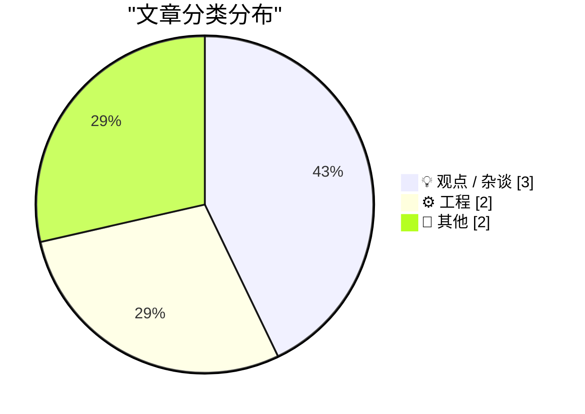
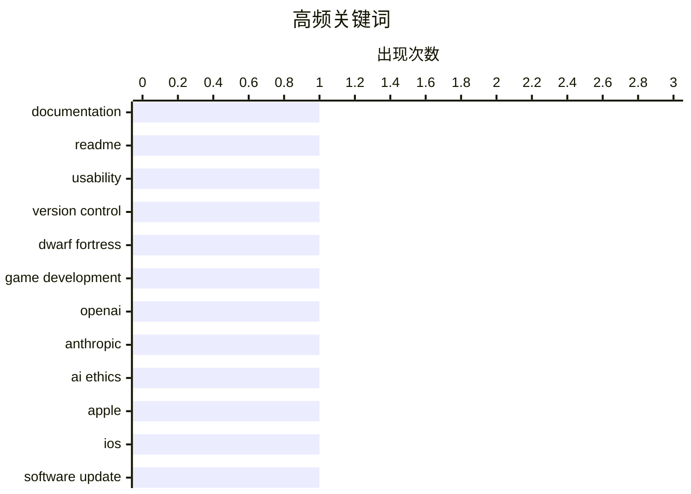

# 📰 AI 博客每日精选

**日期**: 2026-10-12 &nbsp;|&nbsp; **精选**: 7 篇 &nbsp;|&nbsp; **时间范围**: 24 小时

> 📚 来自 Karpathy 推荐的 **92** 个顶级技术博客，经 AI 智能评分筛选

## 📑 目录

- [📝 今日看点](#-今日看点)
- [🏆 今日必读](#-今日必读)
- [📊 数据概览](#-数据概览)
- [💡 观点 / 杂谈](#-观点---杂谈) (3篇)
- [⚙️ 工程](#-工程) (2篇)
- [📝 其他](#-其他) (2篇)

---

## 📝 今日看点

<div style="background: linear-gradient(135deg, #667eea 0%, #764ba2 100%); padding: 16px 20px; border-radius: 12px; color: white; margin: 20px 0;">

今日技术圈的一个明显趋势是“重新审视基础实践”：从开发者终于开始像做用户测试一样验证 README 的可操作性，到《矮人要塞》这个以复杂著称的项目终于引入版本控制，都说明行业在回头修补那些被长期忽视的工程基本功。与此同时，对科技巨头的批判声浪持续升温，有作者直接对 OpenAI 和 Anthropic 说不，将科技寡头与“末日法西斯主义”联系起来，而 X 平台在 Musk 治下的面目全非也成为讽刺对象。此外，苹果直到三天前才建议 iOS 26 用户升级到 iOS 27，这种迟缓的更新推送策略也引发关注。

</div>

---

## 🏆 今日必读

### 🥇 [我花钱请人照着我的 README 操作](https://shkspr.mobi/blog/2026/10/i-paid-people-to-try-and-follow-my-readme/)

<div style="display: flex; gap: 16px; flex-wrap: wrap; margin: 12px 0; font-size: 14px; color: #666;">
<span>📁 ⚙️ 工程</span>
<span>⏰ 12 小时前</span>
<span>⭐ 评分 22/30</span>
</div>

<div style="background: #f8f9fa; border-left: 4px solid #667eea; padding: 16px 20px; border-radius: 8px; margin: 16px 0;">

开发者普遍不擅长写文档，README 常常是一堆过时笔记、失效链接和无人维护的论坛入口，用户只能反复问同样的问题。作者认为更好的做法是像做用户测试一样，真正坐下来观察别人按照 README 操作，看他们在哪里卡住、哪里误解。于是他付费请人尝试跟随自己的 README 完成任务，用真实反馈暴露文档中的盲点和假设。核心观点是：文档不是写完就完事，必须通过实际可用性测试来验证，否则 RTFM 只是一句推卸责任的空话。

</div>

**💡 为什么值得读**: 用一次真实的付费可用性测试，把“写文档”从自我感觉良好变成可验证的工程实践，适合所有需要写 README 或技术文档的人参考。

**🏷️ 标签**: <span style="display:inline-block;background:#e3f2fd;color:#1976D2;padding:4px 12px;border-radius:16px;font-size:12px;margin-right:6px;">documentation</span><span style="display:inline-block;background:#e3f2fd;color:#1976D2;padding:4px 12px;border-radius:16px;font-size:12px;margin-right:6px;">README</span><span style="display:inline-block;background:#e3f2fd;color:#1976D2;padding:4px 12px;border-radius:16px;font-size:12px;margin-right:6px;">usability</span>

---

### 🥈 [《矮人要塞》现在也用版本控制了](https://simonwillison.net/2026/Oct/11/dwarf-fortress/)

<div style="display: flex; gap: 16px; flex-wrap: wrap; margin: 12px 0; font-size: 14px; color: #666;">
<span>📁 ⚙️ 工程</span>
<span>⏰ 23 小时前</span>
<span>⭐ 评分 21/30</span>
</div>

<div style="background: #f8f9fa; border-left: 4px solid #667eea; padding: 16px 20px; border-radius: 8px; margin: 16px 0;">

作者一直记得《矮人要塞》不使用版本控制这件事，因为以这款游戏的代码复杂度而言，它几乎是最需要版本控制的项目。如今这一时代已经结束，文章引用 Tarn Adams 多年来的说法，梳理了从 2013 年“没有版本控制”到后来引入版本控制的变化过程。核心观点是：即使是长期靠个人意志维护的复杂项目，最终也不得不承认版本控制的价值。

</div>

**💡 为什么值得读**: 用一个传奇项目的转变，说明版本控制不是“最佳实践”而是复杂代码库的生存底线，对开发者有很强的说服力。

**🏷️ 标签**: <span style="display:inline-block;background:#e3f2fd;color:#1976D2;padding:4px 12px;border-radius:16px;font-size:12px;margin-right:6px;">version control</span><span style="display:inline-block;background:#e3f2fd;color:#1976D2;padding:4px 12px;border-radius:16px;font-size:12px;margin-right:6px;">Dwarf Fortress</span><span style="display:inline-block;background:#e3f2fd;color:#1976D2;padding:4px 12px;border-radius:16px;font-size:12px;margin-right:6px;">game development</span>

---

### 🥉 [直接对 OpenAI 和 Anthropic 说不](https://micahflee.com/just-say-no-to-openai-and-anthropic/)

<div style="display: flex; gap: 16px; flex-wrap: wrap; margin: 12px 0; font-size: 14px; color: #666;">
<span>📁 💡 观点 / 杂谈</span>
<span>⏰ 58 分钟前</span>
<span>⭐ 评分 21/30</span>
</div>

<div style="background: #f8f9fa; border-left: 4px solid #667eea; padding: 16px 20px; border-radius: 8px; margin: 16px 0;">

作者读完 Naomi Klein 与 Astra Taylor 的《End Times Fascism and the Fight for the Living World》后，认为科技寡头是“末日法西斯联盟”的重要组成部分。文章由此展开，讨论为什么应该拒绝 OpenAI 和 Anthropic 这类 AI 公司，而不是把它们当作中立工具。核心观点是：使用这些服务不只是技术选择，也是在为特定的权力结构投票。

</div>

**💡 为什么值得读**: 把 AI 工具选择放进政治与伦理框架中讨论，适合想认真思考“用不用 OpenAI/Anthropic”背后代价的读者。

**🏷️ 标签**: <span style="display:inline-block;background:#e3f2fd;color:#1976D2;padding:4px 12px;border-radius:16px;font-size:12px;margin-right:6px;">OpenAI</span><span style="display:inline-block;background:#e3f2fd;color:#1976D2;padding:4px 12px;border-radius:16px;font-size:12px;margin-right:6px;">Anthropic</span><span style="display:inline-block;background:#e3f2fd;color:#1976D2;padding:4px 12px;border-radius:16px;font-size:12px;margin-right:6px;">AI ethics</span>

---

## 📊 数据概览

<div style="display: grid; grid-template-columns: repeat(auto-fit, minmax(120px, 1fr)); gap: 12px; margin: 20px 0;">
<div style="background: #e8f4f8; padding: 16px; border-radius: 10px; text-align: center;">
<div style="font-size: 24px; font-weight: bold; color: #2196F3;">85/92</div>
<div style="font-size: 13px; color: #666; margin-top: 4px;">扫描源</div>
</div>
<div style="background: #fff3e0; padding: 16px; border-radius: 10px; text-align: center;">
<div style="font-size: 24px; font-weight: bold; color: #FF9800;">2386</div>
<div style="font-size: 13px; color: #666; margin-top: 4px;">抓取文章</div>
</div>
<div style="background: #f3e5f5; padding: 16px; border-radius: 10px; text-align: center;">
<div style="font-size: 24px; font-weight: bold; color: #9C27B0;">7</div>
<div style="font-size: 13px; color: #666; margin-top: 4px;">时间范围内</div>
</div>
<div style="background: #e8f5e9; padding: 16px; border-radius: 10px; text-align: center;">
<div style="font-size: 24px; font-weight: bold; color: #4CAF50;">7</div>
<div style="font-size: 13px; color: #666; margin-top: 4px;">AI 精选</div>
</div>
</div>

### 🥧 分类分布



### 📈 高频关键词



<details style="margin: 16px 0; padding: 12px; background: #f5f5f5; border-radius: 8px;">
<summary style="cursor: pointer; font-weight: 500;">📊 纯文本关键词图（终端友好）</summary>

```
documentation    │ ████████████████████ 1
readme           │ ████████████████████ 1
usability        │ ████████████████████ 1
version control  │ ████████████████████ 1
dwarf fortress   │ ████████████████████ 1
game development │ ████████████████████ 1
openai           │ ████████████████████ 1
anthropic        │ ████████████████████ 1
ai ethics        │ ████████████████████ 1
apple            │ ████████████████████ 1
```

</details>

### 🏷️ 话题标签

<div style="line-height: 2; margin: 16px 0;">
**documentation**(1) · **readme**(1) · **usability**(1) · version control(1) · dwarf fortress(1) · game development(1) · openai(1) · anthropic(1) · ai ethics(1) · apple(1) · ios(1) · software update(1) · x(1) · elon musk(1) · social media(1) · boredom(1) · productivity(1) · motivation(1) · xmodem(1) · bulletin board(1)
</div>

---

<a id="-观点---杂谈"></a>
## 💡 观点 / 杂谈 <span style="background: #e0e0e0; padding: 2px 10px; border-radius: 12px; font-size: 13px; margin-left: 8px;">3篇</span>

### 1. [直接对 OpenAI 和 Anthropic 说不](https://micahflee.com/just-say-no-to-openai-and-anthropic/)

<div style="margin: 10px 0;">
<div style="display: flex; justify-content: space-between; font-size: 13px; margin-bottom: 4px;">
<span>⭐ 综合评分</span>
<span style="font-weight: bold; color: #FF9800;">21/30</span>
</div>
<div style="background: #e0e0e0; height: 8px; border-radius: 4px; overflow: hidden;">
<div style="background: #FF9800; width: 70%; height: 100%; border-radius: 4px;"></div>
</div>
</div>

<div style="display: flex; gap: 12px; flex-wrap: wrap; font-size: 13px; color: #666; margin: 12px 0;">
<span>📁 micahflee.com</span>
<span>⏰ 58 分钟前</span>
<span>🔖 R:7 Q:7 T:7</span>
</div>

<div style="background: #fafafa; border-radius: 8px; padding: 16px; margin: 12px 0; line-height: 1.7;">
作者读完 Naomi Klein 与 Astra Taylor 的《End Times Fascism and the Fight for the Living World》后，认为科技寡头是“末日法西斯联盟”的重要组成部分。文章由此展开，讨论为什么应该拒绝 OpenAI 和 Anthropic 这类 AI 公司，而不是把它们当作中立工具。核心观点是：使用这些服务不只是技术选择，也是在为特定的权力结构投票。
</div>

<div style="margin: 12px 0;">
<span style="display: inline-block; background: #e3f2fd; color: #1976D2; padding: 4px 12px; border-radius: 16px; font-size: 12px; margin-right: 6px; margin-bottom: 4px;">OpenAI</span><span style="display: inline-block; background: #e3f2fd; color: #1976D2; padding: 4px 12px; border-radius: 16px; font-size: 12px; margin-right: 6px; margin-bottom: 4px;">Anthropic</span><span style="display: inline-block; background: #e3f2fd; color: #1976D2; padding: 4px 12px; border-radius: 16px; font-size: 12px; margin-right: 6px; margin-bottom: 4px;">AI ethics</span>
</div>

---

### 2. [X 又一次标记了那个点](https://daringfireball.net/2026/10/x_once_again_marks_the_spot)

<div style="margin: 10px 0;">
<div style="display: flex; justify-content: space-between; font-size: 13px; margin-bottom: 4px;">
<span>⭐ 综合评分</span>
<span style="font-weight: bold; color: #FF9800;">19/30</span>
</div>
<div style="background: #e0e0e0; height: 8px; border-radius: 4px; overflow: hidden;">
<div style="background: #FF9800; width: 63%; height: 100%; border-radius: 4px;"></div>
</div>
</div>

<div style="display: flex; gap: 12px; flex-wrap: wrap; font-size: 13px; color: #666; margin: 12px 0;">
<span>📁 daringfireball.net</span>
<span>⏰ 2 小时前</span>
<span>🔖 R:5 Q:6 T:8</span>
</div>

<div style="background: #fafafa; border-radius: 8px; padding: 16px; margin: 12px 0; line-height: 1.7;">
作者设想一个离开文明一年、从荒岛回来的人第一次打开 X，很可能会以为 Elon Musk 已经厌倦并把平台卖掉了。文章以此讽刺 X 当前的状态，暗示平台在 Musk 治下已经变得面目全非。核心观点是：X 的变化之大，已经让“换主人”成为最合理的解释。
</div>

<div style="margin: 12px 0;">
<span style="display: inline-block; background: #e3f2fd; color: #1976D2; padding: 4px 12px; border-radius: 16px; font-size: 12px; margin-right: 6px; margin-bottom: 4px;">X</span><span style="display: inline-block; background: #e3f2fd; color: #1976D2; padding: 4px 12px; border-radius: 16px; font-size: 12px; margin-right: 6px; margin-bottom: 4px;">Elon Musk</span><span style="display: inline-block; background: #e3f2fd; color: #1976D2; padding: 4px 12px; border-radius: 16px; font-size: 12px; margin-right: 6px; margin-bottom: 4px;">social media</span>
</div>

---

### 3. [我为什么会感到无聊](https://idiallo.com/byte-size/why-i-get-bored)

<div style="margin: 10px 0;">
<div style="display: flex; justify-content: space-between; font-size: 13px; margin-bottom: 4px;">
<span>⭐ 综合评分</span>
<span style="font-weight: bold; color: #FF9800;">18/30</span>
</div>
<div style="background: #e0e0e0; height: 8px; border-radius: 4px; overflow: hidden;">
<div style="background: #FF9800; width: 60%; height: 100%; border-radius: 4px;"></div>
</div>
</div>

<div style="display: flex; gap: 12px; flex-wrap: wrap; font-size: 13px; color: #666; margin: 12px 0;">
<span>📁 idiallo.com</span>
<span>⏰ 8 小时前</span>
<span>🔖 R:6 Q:7 T:5</span>
</div>

<div style="background: #fafafa; border-radius: 8px; padding: 16px; margin: 12px 0; line-height: 1.7;">
作者把无聊视为一种信号：它意味着自己撞上了障碍，大脑在劝他放弃，而不是真的对事情失去兴趣。他以自己做 YouTube 视频为例，说明在写脚本、录制、进入 DaVinci Resolve 剪辑的过程中，一旦遇到不擅长的环节就会感到无聊。在当前的工作、家庭和责任安排下，他很难投入足够时间突破这些障碍。核心观点是：无聊往往不是缺乏兴趣，而是遇到困难后大脑给出的逃避借口。
</div>

<div style="margin: 12px 0;">
<span style="display: inline-block; background: #e3f2fd; color: #1976D2; padding: 4px 12px; border-radius: 16px; font-size: 12px; margin-right: 6px; margin-bottom: 4px;">boredom</span><span style="display: inline-block; background: #e3f2fd; color: #1976D2; padding: 4px 12px; border-radius: 16px; font-size: 12px; margin-right: 6px; margin-bottom: 4px;">productivity</span><span style="display: inline-block; background: #e3f2fd; color: #1976D2; padding: 4px 12px; border-radius: 16px; font-size: 12px; margin-right: 6px; margin-bottom: 4px;">motivation</span>
</div>

---

<a id="-工程"></a>
## ⚙️ 工程 <span style="background: #e0e0e0; padding: 2px 10px; border-radius: 12px; font-size: 13px; margin-left: 8px;">2篇</span>

### 4. [我花钱请人照着我的 README 操作](https://shkspr.mobi/blog/2026/10/i-paid-people-to-try-and-follow-my-readme/)

<div style="margin: 10px 0;">
<div style="display: flex; justify-content: space-between; font-size: 13px; margin-bottom: 4px;">
<span>⭐ 综合评分</span>
<span style="font-weight: bold; color: #FF9800;">22/30</span>
</div>
<div style="background: #e0e0e0; height: 8px; border-radius: 4px; overflow: hidden;">
<div style="background: #FF9800; width: 73%; height: 100%; border-radius: 4px;"></div>
</div>
</div>

<div style="display: flex; gap: 12px; flex-wrap: wrap; font-size: 13px; color: #666; margin: 12px 0;">
<span>📁 shkspr.mobi</span>
<span>⏰ 12 小时前</span>
<span>🔖 R:8 Q:8 T:6</span>
</div>

<div style="background: #fafafa; border-radius: 8px; padding: 16px; margin: 12px 0; line-height: 1.7;">
开发者普遍不擅长写文档，README 常常是一堆过时笔记、失效链接和无人维护的论坛入口，用户只能反复问同样的问题。作者认为更好的做法是像做用户测试一样，真正坐下来观察别人按照 README 操作，看他们在哪里卡住、哪里误解。于是他付费请人尝试跟随自己的 README 完成任务，用真实反馈暴露文档中的盲点和假设。核心观点是：文档不是写完就完事，必须通过实际可用性测试来验证，否则 RTFM 只是一句推卸责任的空话。
</div>

<div style="margin: 12px 0;">
<span style="display: inline-block; background: #e3f2fd; color: #1976D2; padding: 4px 12px; border-radius: 16px; font-size: 12px; margin-right: 6px; margin-bottom: 4px;">documentation</span><span style="display: inline-block; background: #e3f2fd; color: #1976D2; padding: 4px 12px; border-radius: 16px; font-size: 12px; margin-right: 6px; margin-bottom: 4px;">README</span><span style="display: inline-block; background: #e3f2fd; color: #1976D2; padding: 4px 12px; border-radius: 16px; font-size: 12px; margin-right: 6px; margin-bottom: 4px;">usability</span>
</div>

---

### 5. [《矮人要塞》现在也用版本控制了](https://simonwillison.net/2026/Oct/11/dwarf-fortress/)

<div style="margin: 10px 0;">
<div style="display: flex; justify-content: space-between; font-size: 13px; margin-bottom: 4px;">
<span>⭐ 综合评分</span>
<span style="font-weight: bold; color: #FF9800;">21/30</span>
</div>
<div style="background: #e0e0e0; height: 8px; border-radius: 4px; overflow: hidden;">
<div style="background: #FF9800; width: 70%; height: 100%; border-radius: 4px;"></div>
</div>
</div>

<div style="display: flex; gap: 12px; flex-wrap: wrap; font-size: 13px; color: #666; margin: 12px 0;">
<span>📁 simonwillison.net</span>
<span>⏰ 23 小时前</span>
<span>🔖 R:7 Q:6 T:8</span>
</div>

<div style="background: #fafafa; border-radius: 8px; padding: 16px; margin: 12px 0; line-height: 1.7;">
作者一直记得《矮人要塞》不使用版本控制这件事，因为以这款游戏的代码复杂度而言，它几乎是最需要版本控制的项目。如今这一时代已经结束，文章引用 Tarn Adams 多年来的说法，梳理了从 2013 年“没有版本控制”到后来引入版本控制的变化过程。核心观点是：即使是长期靠个人意志维护的复杂项目，最终也不得不承认版本控制的价值。
</div>

<div style="margin: 12px 0;">
<span style="display: inline-block; background: #e3f2fd; color: #1976D2; padding: 4px 12px; border-radius: 16px; font-size: 12px; margin-right: 6px; margin-bottom: 4px;">version control</span><span style="display: inline-block; background: #e3f2fd; color: #1976D2; padding: 4px 12px; border-radius: 16px; font-size: 12px; margin-right: 6px; margin-bottom: 4px;">Dwarf Fortress</span><span style="display: inline-block; background: #e3f2fd; color: #1976D2; padding: 4px 12px; border-radius: 16px; font-size: 12px; margin-right: 6px; margin-bottom: 4px;">game development</span>
</div>

---

<a id="-其他"></a>
## 📝 其他 <span style="background: #e0e0e0; padding: 2px 10px; border-radius: 12px; font-size: 13px; margin-left: 8px;">2篇</span>

### 6. [苹果直到三天前才开始建议 iOS 26 用户升级到 iOS 27](https://www.macrumors.com/2026/10/08/apple-now-pushing-ios-27/)

<div style="margin: 10px 0;">
<div style="display: flex; justify-content: space-between; font-size: 13px; margin-bottom: 4px;">
<span>⭐ 综合评分</span>
<span style="font-weight: bold; color: #FF9800;">20/30</span>
</div>
<div style="background: #e0e0e0; height: 8px; border-radius: 4px; overflow: hidden;">
<div style="background: #FF9800; width: 67%; height: 100%; border-radius: 4px;"></div>
</div>
</div>

<div style="display: flex; gap: 12px; flex-wrap: wrap; font-size: 13px; color: #666; margin: 12px 0;">
<span>📁 daringfireball.net</span>
<span>⏰ 4 小时前</span>
<span>🔖 R:6 Q:5 T:9</span>
</div>

<div style="background: #fafafa; border-radius: 8px; padding: 16px; margin: 12px 0; line-height: 1.7;">
MacRumors 报道称，从周四开始，仍在使用 iOS 26 的 iPhone 用户才会在“设置 → 通用 → 软件更新”中看到 iOS 27.0.1 作为主要推荐更新，而 iOS 26.7.1 被降级到“也可用”区域。作者此前刚讨论过，大多数用户只有在苹果通过自动更新推送时才会升级系统；但即便是手动检查更新的用户，直到周四之前，iOS 26.x 的默认建议更新也不是 iOS 27。核心观点是：苹果的更新推荐策略会显著影响用户实际升级行为。
</div>

<div style="margin: 12px 0;">
<span style="display: inline-block; background: #e3f2fd; color: #1976D2; padding: 4px 12px; border-radius: 16px; font-size: 12px; margin-right: 6px; margin-bottom: 4px;">Apple</span><span style="display: inline-block; background: #e3f2fd; color: #1976D2; padding: 4px 12px; border-radius: 16px; font-size: 12px; margin-right: 6px; margin-bottom: 4px;">iOS</span><span style="display: inline-block; background: #e3f2fd; color: #1976D2; padding: 4px 12px; border-radius: 16px; font-size: 12px; margin-right: 6px; margin-bottom: 4px;">software update</span>
</div>

---

### 7. [Ward Christensen：电信先驱](https://dfarq.homeip.net/ward-christensen-telecommunications-pioneer/?utm_source=rss&#038;utm_medium=rss&#038;utm_campaign=ward-christensen-telecommunications-pioneer)

<div style="margin: 10px 0;">
<div style="display: flex; justify-content: space-between; font-size: 13px; margin-bottom: 4px;">
<span>⭐ 综合评分</span>
<span style="font-weight: bold; color: #f44336;">17/30</span>
</div>
<div style="background: #e0e0e0; height: 8px; border-radius: 4px; overflow: hidden;">
<div style="background: #f44336; width: 57%; height: 100%; border-radius: 4px;"></div>
</div>
</div>

<div style="display: flex; gap: 12px; flex-wrap: wrap; font-size: 13px; color: #666; margin: 12px 0;">
<span>📁 dfarq.homeip.net</span>
<span>⏰ 13 小时前</span>
<span>🔖 R:6 Q:7 T:4</span>
</div>

<div style="background: #fafafa; border-radius: 8px; padding: 16px; margin: 12px 0; line-height: 1.7;">
Ward Christensen 于 1945 年 10 月 23 日出生在威斯康星州 West Bend，2024 年 10 月 11 日在芝加哥郊区 Rolling Meadows 去世，享年 78 岁。他发明了 Xmodem 文件传输协议，并参与共同发明了电子公告板系统（BBS）。文章回顾了他在电信和早期网络文化中的奠基性贡献。核心观点是：现代在线通信的许多基础，可以追溯到 Christensen 这样的先驱。
</div>

<div style="margin: 12px 0;">
<span style="display: inline-block; background: #e3f2fd; color: #1976D2; padding: 4px 12px; border-radius: 16px; font-size: 12px; margin-right: 6px; margin-bottom: 4px;">Xmodem</span><span style="display: inline-block; background: #e3f2fd; color: #1976D2; padding: 4px 12px; border-radius: 16px; font-size: 12px; margin-right: 6px; margin-bottom: 4px;">bulletin board</span><span style="display: inline-block; background: #e3f2fd; color: #1976D2; padding: 4px 12px; border-radius: 16px; font-size: 12px; margin-right: 6px; margin-bottom: 4px;">telecommunications</span>
</div>

---


<div style="text-align: center; color: #888; font-size: 13px; padding: 20px; border-top: 1px solid #e0e0e0; margin-top: 30px;">
生成于 2026-10-12 00:01 | 扫描 <strong>85</strong> 源 → 获取 <strong>2386</strong> 篇 → 精选 <strong>7</strong> 篇
<br>
基于 <a href="https://refactoringenglish.com/tools/hn-popularity/" style="color: #667eea;">Hacker News Popularity Contest 2025</a> RSS 源列表，由 <a href="https://x.com/karpathy" style="color: #667eea;">Andrej Karpathy</a> 推荐
<br>
由「懂点儿 AI」制作，欢迎关注同名微信公众号获取更多 AI 实用技巧 💡
</div>
