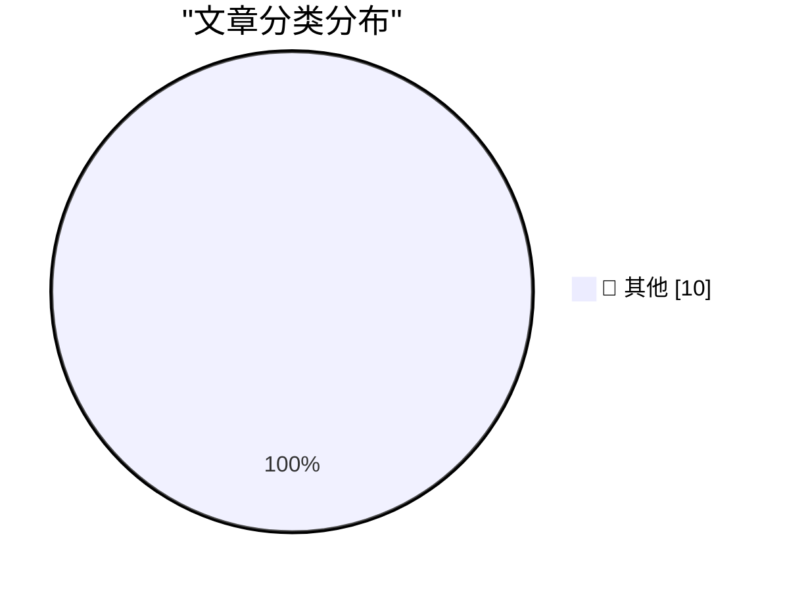

# 📰 AI 博客每日精选

**日期**: 2026-10-13 &nbsp;|&nbsp; **精选**: 10 篇 &nbsp;|&nbsp; **时间范围**: 24 小时

> 📚 来自 Karpathy 推荐的 **92** 个顶级技术博客，经 AI 智能评分筛选

## 📑 目录

- [📝 今日看点](#-今日看点)
- [🏆 今日必读](#-今日必读)
- [📊 数据概览](#-数据概览)
- [📝 其他](#-其他) (10篇)

---

## 🏆 今日必读

### 🥇 [Hello Python 3.15, goodbye 3.10, and now I can use 3.11](https://simonwillison.net/2026/Oct/12/python-3-15/)

📁 📝 其他
⏰ 5 小时前
⭐ 评分 15/30

Hello Python 3.15, goodbye 3.10, and now I can use 3.11

---

### 🥈 [datasette-ports 0.4](https://simonwillison.net/2026/Oct/12/datasette-ports/)

📁 📝 其他
⏰ 19 小时前
⭐ 评分 15/30

datasette-ports 0.4

---

### 🥉 [Mark Stephens, a.k.a. Robert X. Cringely, Died at 73](https://www.facebook.com/story.php?story_fbid=pfbid0YbCLrAJfBirAWuPBy4a7pauaQ6gHkAPUwtbzyg2wAjeMcruFC7dWUZKQJKkNChP9l&amp;id=536506060&amp;_rdr)

📁 📝 其他
⏰ 7 小时前
⭐ 评分 15/30

Mark Stephens, a.k.a. Robert X. Cringely, Died at 73

---

## 📊 数据概览

86/92

扫描源

2616

抓取文章

10

时间范围内

10

AI 精选

### 🥧 分类分布

---

## 📝 其他 10篇

### 1. [Hello Python 3.15, goodbye 3.10, and now I can use 3.11](https://simonwillison.net/2026/Oct/12/python-3-15/)

⭐ 综合评分
15/30

📁 simonwillison.net
⏰ 5 小时前
🔖 R:5 Q:5 T:5

Hello Python 3.15, goodbye 3.10, and now I can use 3.11

---

### 2. [datasette-ports 0.4](https://simonwillison.net/2026/Oct/12/datasette-ports/)

⭐ 综合评分
15/30

📁 simonwillison.net
⏰ 19 小时前
🔖 R:5 Q:5 T:5

datasette-ports 0.4

---

### 3. [Mark Stephens, a.k.a. Robert X. Cringely, Died at 73](https://www.facebook.com/story.php?story_fbid=pfbid0YbCLrAJfBirAWuPBy4a7pauaQ6gHkAPUwtbzyg2wAjeMcruFC7dWUZKQJKkNChP9l&amp;id=536506060&amp;_rdr)

⭐ 综合评分
15/30

📁 daringfireball.net
⏰ 7 小时前
🔖 R:5 Q:5 T:5

Mark Stephens, a.k.a. Robert X. Cringely, Died at 73

---

### 4. [Pluralistic: How labor rights rescued Ultima from a monopolist (12 Oct 2026)](https://pluralistic.net/2026/10/12/termination-of-transfer/)

⭐ 综合评分
15/30

📁 pluralistic.net
⏰ 12 小时前
🔖 R:5 Q:5 T:5

Pluralistic: How labor rights rescued Ultima from a monopolist (12 Oct 2026)

---

### 5. [Categorical models of logics](https://www.johndcook.com/blog/2026/10/12/categorical-models-of-logics/)

⭐ 综合评分
15/30

📁 johndcook.com
⏰ 10 小时前
🔖 R:5 Q:5 T:5

Categorical models of logics

---

### 6. [Now That’s What I Call Technical Debt!](https://nesbitt.io/2026/10/12/now-thats-what-i-call-technical-debt.html)

⭐ 综合评分
15/30

📁 nesbitt.io
⏰ 15 小时前
🔖 R:5 Q:5 T:5

Now That’s What I Call Technical Debt!

---

### 7. [The X is Off-Target](https://feed.tedium.co/link/15204/17494770/x-social-media-monoliths-critique)

⭐ 综合评分
15/30

📁 tedium.co
⏰ 8 小时前
🔖 R:5 Q:5 T:5

The X is Off-Target

---

### 8. [The Dock on Mac, From OS 10 to macOS 27](https://blog.jim-nielsen.com/2026/macos-dock-icons-over-time/)

⭐ 综合评分
15/30

📁 blog.jim-nielsen.com
⏰ 5 小时前
🔖 R:5 Q:5 T:5

The Dock on Mac, From OS 10 to macOS 27

---

### 9. [Nvidia’s first GPU: GeForce 256](https://dfarq.homeip.net/nvidias-first-gpu-geforce-256/?utm_source=rss&#038;utm_medium=rss&#038;utm_campaign=nvidias-first-gpu-geforce-256)

⭐ 综合评分
15/30

📁 dfarq.homeip.net
⏰ 13 小时前
🔖 R:5 Q:5 T:5

Nvidia’s first GPU: GeForce 256

---

### 10. [Refurb weekend II: Alpha Micro Eagle 300 and friends](https://oldvcr.blogspot.com/feeds/3996311687258717625/comments/default)

⭐ 综合评分
15/30

📁 oldvcr.blogspot.com
⏰ 22 小时前
🔖 R:5 Q:5 T:5

Refurb weekend II: Alpha Micro Eagle 300 and friends

---

生成于 2026-10-13 00:02 | 扫描 <strong>86</strong> 源 → 获取 <strong>2616</strong> 篇 → 精选 <strong>10</strong> 篇
 
基于 <a href="https://refactoringenglish.com/tools/hn-popularity/" style="color: #667eea;">Hacker News Popularity Contest 2025</a> RSS 源列表，由 <a href="https://x.com/karpathy" style="color: #667eea;">Andrej Karpathy</a> 推荐
 
由「懂点儿 AI」制作，欢迎关注同名微信公众号获取更多 AI 实用技巧 💡

