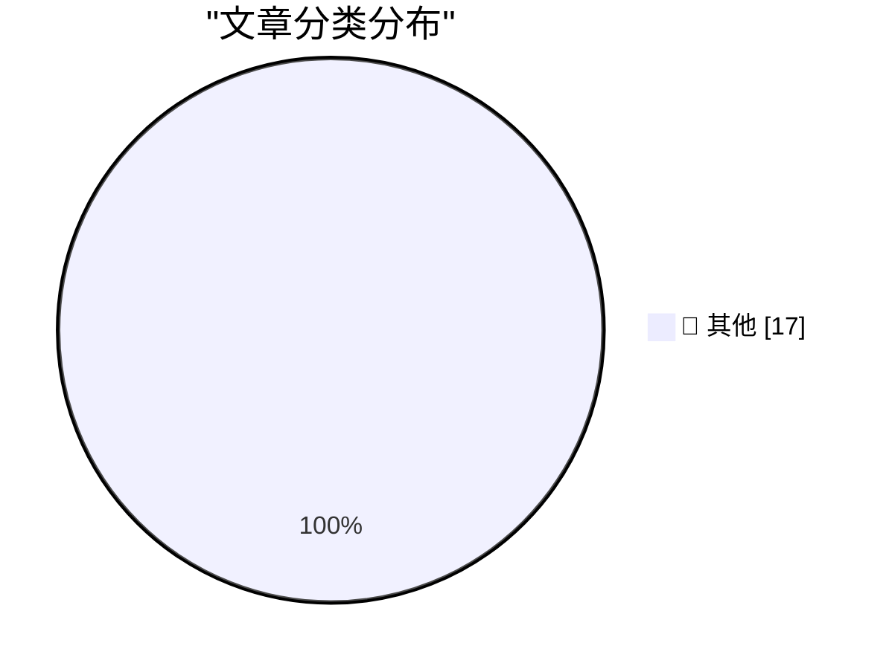

# 📰 AI 博客每日精选

**日期**: 2026-10-14 &nbsp;|&nbsp; **精选**: 17 篇 &nbsp;|&nbsp; **时间范围**: 24 小时

> 📚 来自 Karpathy 推荐的 **92** 个顶级技术博客，经 AI 智能评分筛选

## 📑 目录

- [📝 今日看点](#-今日看点)
- [🏆 今日必读](#-今日必读)
- [📊 数据概览](#-数据概览)
- [📝 其他](#-其他) (17篇)

---

## 🏆 今日必读

### 🥇 [Redesigning source control at Anthropic](https://simonwillison.net/2026/Oct/13/redesigning-source-control-at-anthropic/)

📁 📝 其他
⏰ 1 小时前
⭐ 评分 15/30

Redesigning source control at Anthropic

---

### 🥈 [llm-gemini 0.35](https://simonwillison.net/2026/Oct/13/llm-gemini/)

📁 📝 其他
⏰ 1 小时前
⭐ 评分 15/30

llm-gemini 0.35

---

### 🥉 [Quoting Geoffrey Huntley](https://simonwillison.net/2026/Oct/13/geoffrey-huntley/)

📁 📝 其他
⏰ 10 小时前
⭐ 评分 15/30

Quoting Geoffrey Huntley

---

## 📊 数据概览

87/92

扫描源

2626

抓取文章

17

时间范围内

17

AI 精选

### 🥧 分类分布

---

## 📝 其他 17篇

### 1. [Redesigning source control at Anthropic](https://simonwillison.net/2026/Oct/13/redesigning-source-control-at-anthropic/)

⭐ 综合评分
15/30

📁 simonwillison.net
⏰ 1 小时前
🔖 R:5 Q:5 T:5

Redesigning source control at Anthropic

---

### 2. [llm-gemini 0.35](https://simonwillison.net/2026/Oct/13/llm-gemini/)

⭐ 综合评分
15/30

📁 simonwillison.net
⏰ 1 小时前
🔖 R:5 Q:5 T:5

llm-gemini 0.35

---

### 3. [Quoting Geoffrey Huntley](https://simonwillison.net/2026/Oct/13/geoffrey-huntley/)

⭐ 综合评分
15/30

📁 simonwillison.net
⏰ 10 小时前
🔖 R:5 Q:5 T:5

Quoting Geoffrey Huntley

---

### 4. [web-edit 0.1a1](https://simonwillison.net/2026/Oct/13/web-edit/)

⭐ 综合评分
15/30

📁 simonwillison.net
⏰ 22 小时前
🔖 R:5 Q:5 T:5

web-edit 0.1a1

---

### 5. [Microsoft Patches More Than 1,400 Security Flaws](https://krebsonsecurity.com/2026/10/microsoft-patches-more-than-1400-security-flaws/)

⭐ 综合评分
15/30

📁 krebsonsecurity.com
⏰ 44 分钟前
🔖 R:5 Q:5 T:5

Microsoft Patches More Than 1,400 Security Flaws

---

### 6. [Apple HomeView](https://www.apple.com/newsroom/2026/10/meet-apple-homeview-a-new-way-to-enjoy-entertainment-and-manage-the-home/)

⭐ 综合评分
15/30

📁 daringfireball.net
⏰ 9 小时前
🔖 R:5 Q:5 T:5

Apple HomeView

---

### 7. [The Last Answer](https://idiallo.com/blog/the-last-answer)

⭐ 综合评分
15/30

📁 idiallo.com
⏰ 14 小时前
🔖 R:5 Q:5 T:5

The Last Answer

---

### 8. [Pluralistic: Bundestrojaner (13 Oct 2026)](https://pluralistic.net/2026/10/13/petards-r-us/)

⭐ 综合评分
15/30

📁 pluralistic.net
⏰ 12 小时前
🔖 R:5 Q:5 T:5

Pluralistic: Bundestrojaner (13 Oct 2026)

---

### 9. [Book Review: The Thousand Deaths of Romeo and Juliet - Caroline Finch ★★★★★](https://shkspr.mobi/blog/2026/10/book-review-the-thousand-deaths-of-romeo-and-juliet-caroline-finch/)

⭐ 综合评分
15/30

📁 shkspr.mobi
⏰ 12 小时前
🔖 R:5 Q:5 T:5

Book Review: The Thousand Deaths of Romeo and Juliet - Caroline Finch ★★★★★

---

### 10. [C++ futures part 2: The mental model for std::promise, std::packaged_task](https://devblogs.microsoft.com/oldnewthing/20261013-00/?p=112769/)

⭐ 综合评分
15/30

📁 devblogs.microsoft.com/oldnewthing
⏰ 10 小时前
🔖 R:5 Q:5 T:5

C++ futures part 2: The mental model for std::promise, std::packaged_task

---

### 11. [Could this be the Frontier Labs’ WeWork moment?](https://garymarcus.substack.com/p/could-this-be-the-frontier-labs-wework)

⭐ 综合评分
15/30

📁 garymarcus.substack.com
⏰ 23 小时前
🔖 R:5 Q:5 T:5

Could this be the Frontier Labs’ WeWork moment?

---

### 12. [Harmonic triangle](https://www.johndcook.com/blog/2026/10/13/harmonic-triangle/)

⭐ 综合评分
15/30

📁 johndcook.com
⏰ 10 小时前
🔖 R:5 Q:5 T:5

Harmonic triangle

---

### 13. [Annualized Enron Rate](https://www.wheresyoured.at/annualized-enron-rate/)

⭐ 综合评分
15/30

📁 wheresyoured.at
⏰ 8 小时前
🔖 R:5 Q:5 T:5

Annualized Enron Rate

---

### 14. [What happened to Ashton-Tate and dBase](https://dfarq.homeip.net/what-happened-to-ashton-tate-and-dbase/?utm_source=rss&#038;utm_medium=rss&#038;utm_campaign=what-happened-to-ashton-tate-and-dbase)

⭐ 综合评分
15/30

📁 dfarq.homeip.net
⏰ 13 小时前
🔖 R:5 Q:5 T:5

What happened to Ashton-Tate and dBase

---

### 15. [Subterranean Warfare – An Urgent DoW Need Without An Owner](https://steveblank.com/2026/10/13/subterranean-warfare-an-urgent-dow-need-without-an-owner/)

⭐ 综合评分
15/30

📁 steveblank.com
⏰ 11 小时前
🔖 R:5 Q:5 T:5

Subterranean Warfare – An Urgent DoW Need Without An Owner

---

### 16. [Weekly Update 525: AI Data Breach Hyperbole](https://www.troyhunt.com/weekly-update-525/)

⭐ 综合评分
15/30

📁 troyhunt.com
⏰ 13 小时前
🔖 R:5 Q:5 T:5

Weekly Update 525: AI Data Breach Hyperbole

---

### 17. [Claude, don’t touch my lump](https://www.experimental-history.com/p/claude-dont-touch-my-lump)

⭐ 综合评分
15/30

📁 experimental-history.com
⏰ 3 小时前
🔖 R:5 Q:5 T:5

Claude, don’t touch my lump

---

生成于 2026-10-14 00:09 | 扫描 <strong>87</strong> 源 → 获取 <strong>2626</strong> 篇 → 精选 <strong>17</strong> 篇
 
基于 <a href="https://refactoringenglish.com/tools/hn-popularity/" style="color: #667eea;">Hacker News Popularity Contest 2025</a> RSS 源列表，由 <a href="https://x.com/karpathy" style="color: #667eea;">Andrej Karpathy</a> 推荐
 
由「懂点儿 AI」制作，欢迎关注同名微信公众号获取更多 AI 实用技巧 💡

