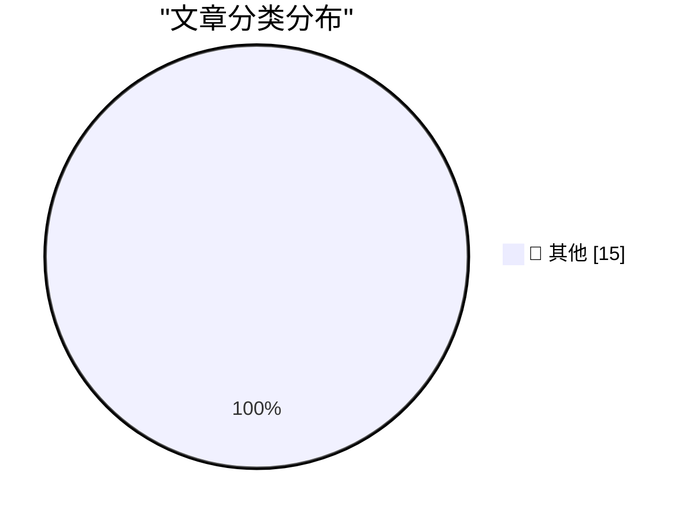

# 📰 AI 博客每日精选

**日期**: 2026-10-20 &nbsp;|&nbsp; **精选**: 15 篇 &nbsp;|&nbsp; **时间范围**: 24 小时

> 📚 来自 Karpathy 推荐的 **92** 个顶级技术博客，经 AI 智能评分筛选

## 📑 目录

- [📝 今日看点](#-今日看点)
- [🏆 今日必读](#-今日必读)
- [📊 数据概览](#-数据概览)
- [📝 其他](#-其他) (15篇)

---

## 🏆 今日必读

### 🥇 [Feds Suspect Ransom Negotiator Ran ShinyHunters Extortion Site](https://krebsonsecurity.com/2026/10/feds-suspect-ransom-negotiator-ran-shinyhunters-extortion-site/)

📁 📝 其他
⏰ 10 小时前
⭐ 评分 15/30

Feds Suspect Ransom Negotiator Ran ShinyHunters Extortion Site

---

### 🥈 [From the DF Archive: Should a CEO Be a Nerd About Their Company’s Products?](https://daringfireball.net/linked/2022/10/11/ceos-as-nerds)

📁 📝 其他
⏰ 1 小时前
⭐ 评分 15/30

From the DF Archive: Should a CEO Be a Nerd About Their Company’s Products?

---

### 🥉 [Apple Event, in Los Angeles, Next Week: ‘Pro and Tell’](https://x.com/gregjoz/status/2112212372182249831)

📁 📝 其他
⏰ 1 小时前
⭐ 评分 15/30

Apple Event, in Los Angeles, Next Week: ‘Pro and Tell’

---

## 📊 数据概览

85/92

扫描源

2571

抓取文章

15

时间范围内

15

AI 精选

### 🥧 分类分布

---

## 📝 其他 15篇

### 1. [Feds Suspect Ransom Negotiator Ran ShinyHunters Extortion Site](https://krebsonsecurity.com/2026/10/feds-suspect-ransom-negotiator-ran-shinyhunters-extortion-site/)

⭐ 综合评分
15/30

📁 krebsonsecurity.com
⏰ 10 小时前
🔖 R:5 Q:5 T:5

Feds Suspect Ransom Negotiator Ran ShinyHunters Extortion Site

---

### 2. [From the DF Archive: Should a CEO Be a Nerd About Their Company’s Products?](https://daringfireball.net/linked/2022/10/11/ceos-as-nerds)

⭐ 综合评分
15/30

📁 daringfireball.net
⏰ 1 小时前
🔖 R:5 Q:5 T:5

From the DF Archive: Should a CEO Be a Nerd About Their Company’s Products?

---

### 3. [Apple Event, in Los Angeles, Next Week: ‘Pro and Tell’](https://x.com/gregjoz/status/2112212372182249831)

⭐ 综合评分
15/30

📁 daringfireball.net
⏰ 1 小时前
🔖 R:5 Q:5 T:5

Apple Event, in Los Angeles, Next Week: ‘Pro and Tell’

---

### 4. [★ Estimated Arrival Dates for DF Readers’ Pre-Ordered iPhone Duos](https://daringfireball.net/2026/10/estimated_arrival_dates_for_preordered_iphone_duos)

⭐ 综合评分
15/30

📁 daringfireball.net
⏰ 1 小时前
🔖 R:5 Q:5 T:5

★ Estimated Arrival Dates for DF Readers’ Pre-Ordered iPhone Duos

---

### 5. [Netflix Shitcanned Film Chief Dan Lin Too](https://deadline.com/2026/10/netflix-dan-lin-out-1237167562/)

⭐ 综合评分
15/30

📁 daringfireball.net
⏰ 2 小时前
🔖 R:5 Q:5 T:5

Netflix Shitcanned Film Chief Dan Lin Too

---

### 6. [Ex-Apple Employee Fred Potter on HomeView](https://www.linkedin.com/posts/frpotter_tonight-im-looking-back-through-the-photo-share-7515791565718454272-ue-R/)

⭐ 综合评分
15/30

📁 daringfireball.net
⏰ 5 小时前
🔖 R:5 Q:5 T:5

Ex-Apple Employee Fred Potter on HomeView

---

### 7. [Netflix Lays Off 6 Percent of Staff](https://www.wsj.com/business/media/netflix-eliminates-about-6-of-staff-in-biggest-cuts-since-2022-0a2d8ec3?st=NtEg5v&amp;reflink=desktopwebshare_permalink)

⭐ 综合评分
15/30

📁 daringfireball.net
⏰ 7 小时前
🔖 R:5 Q:5 T:5

Netflix Lays Off 6 Percent of Staff

---

### 8. [Time Magazine Profiles John Ternus](https://time.com/collection/best-inventions/2026/apple-iphone-duo/)

⭐ 综合评分
15/30

📁 daringfireball.net
⏰ 7 小时前
🔖 R:5 Q:5 T:5

Time Magazine Profiles John Ternus

---

### 9. [Pluralistic: The technopolitics of ad-tech (19 Oct 2026)](https://pluralistic.net/2026/10/19/spying-v-context/)

⭐ 综合评分
15/30

📁 pluralistic.net
⏰ 16 小时前
🔖 R:5 Q:5 T:5

Pluralistic: The technopolitics of ad-tech (19 Oct 2026)

---

### 10. [Dead German guys](https://blog.coredump.cx/p/dead-german-guys)

⭐ 综合评分
15/30

📁 lcamtuf.substack.com
⏰ 20 小时前
🔖 R:5 Q:5 T:5

Dead German guys

---

### 11. [Refactoring factorials](https://www.johndcook.com/blog/2026/10/19/refactoring-factorials/)

⭐ 综合评分
15/30

📁 johndcook.com
⏰ 9 小时前
🔖 R:5 Q:5 T:5

Refactoring factorials

---

### 12. [A frivolous problem with a deeper lesson](https://www.johndcook.com/blog/2026/10/19/regex-backtracking/)

⭐ 综合评分
15/30

📁 johndcook.com
⏰ 12 小时前
🔖 R:5 Q:5 T:5

A frivolous problem with a deeper lesson

---

### 13. [Who bought Gateway computers?](https://dfarq.homeip.net/bought-gateway-computers/?utm_source=rss&#038;utm_medium=rss&#038;utm_campaign=bought-gateway-computers)

⭐ 综合评分
15/30

📁 dfarq.homeip.net
⏰ 13 小时前
🔖 R:5 Q:5 T:5

Who bought Gateway computers?

---

### 14. [The Lean Educator Conference](https://steveblank.com/2026/10/19/the-lean-educator-conference/)

⭐ 综合评分
15/30

📁 steveblank.com
⏰ 11 小时前
🔖 R:5 Q:5 T:5

The Lean Educator Conference

---

### 15. [Weekly Update 526: Building HIBP AI/SI First](https://www.troyhunt.com/weekly-update-526/)

⭐ 综合评分
15/30

📁 troyhunt.com
⏰ 17 小时前
🔖 R:5 Q:5 T:5

Weekly Update 526: Building HIBP AI/SI First

---

生成于 2026-10-20 00:01 | 扫描 <strong>85</strong> 源 → 获取 <strong>2571</strong> 篇 → 精选 <strong>15</strong> 篇
 
基于 <a href="https://refactoringenglish.com/tools/hn-popularity/" style="color: #667eea;">Hacker News Popularity Contest 2025</a> RSS 源列表，由 <a href="https://x.com/karpathy" style="color: #667eea;">Andrej Karpathy</a> 推荐
 
由「懂点儿 AI」制作，欢迎关注同名微信公众号获取更多 AI 实用技巧 💡

