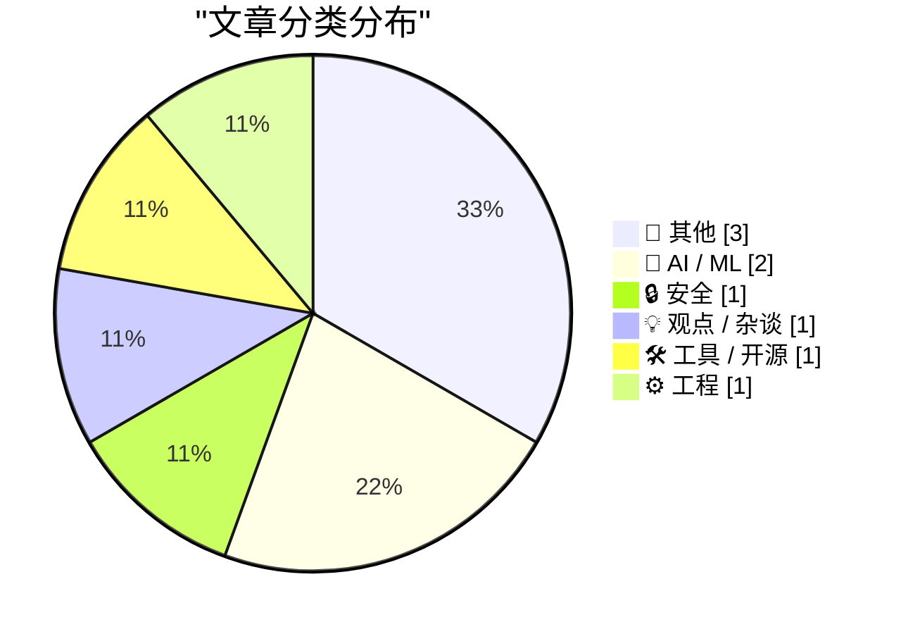
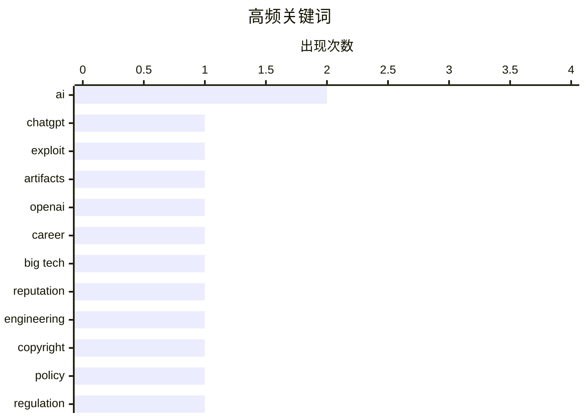

# 📰 AI 博客每日精选

**日期**: 2026-11-01 &nbsp;|&nbsp; **精选**: 9 篇 &nbsp;|&nbsp; **时间范围**: 24 小时

> 📚 来自 Karpathy 推荐的 **92** 个顶级技术博客，经 AI 智能评分筛选

## 📑 目录

- [📝 今日看点](#-今日看点)
- [🏆 今日必读](#-今日必读)
- [📊 数据概览](#-数据概览)
- [📝 其他](#-其他) (3篇)
- [🤖 AI / ML](#-ai---ml) (2篇)
- [🔒 安全](#-安全) (1篇)
- [💡 观点 / 杂谈](#-观点---杂谈) (1篇)
- [🛠 工具 / 开源](#-工具---开源) (1篇)
- [⚙️ 工程](#-工程) (1篇)

---

## 📝 今日看点

<div style="background: linear-gradient(135deg, #667eea 0%, #764ba2 100%); padding: 16px 20px; border-radius: 12px; color: white; margin: 20px 0;">

今日技术圈的安全隐忧持续升温：ChatGPT HTML预览功能被曝出沙箱隔离漏洞，攻击者可借此窃取用户会话，而包管理生态则面临依赖混淆攻击新变种与供应链签名验证的双重挑战。与此同时，AI治理与版权规则正在经历深层调整——美国版权局倾向于恢复"需付出努力方可获权"的传统立场，梵蒂冈方面也对AI武器化与深度伪造表达了明确关切。在工程实践层面，开发者个人基础设施向CDN加对象存储的轻量化迁移，以及大厂工程师如何打破"声誉与重要项目"死循环的讨论，共同折射出技术从业者对效率与职业可见度的务实追求。

</div>

---

## 🏆 今日必读

### 🥇 [我们如何接管ChatGPT账户](https://simonwillison.net/2026/Oct/31/how-we-took-over-chatgpt-accounts/)

<div style="display: flex; gap: 16px; flex-wrap: wrap; margin: 12px 0; font-size: 14px; color: #666;">
<span>📁 🔒 安全</span>
<span>⏰ 45 分钟前</span>
<span>⭐ 评分 26/30</span>
</div>

<div style="background: #f8f9fa; border-left: 4px solid #667eea; padding: 16px 20px; border-radius: 8px; margin: 16px 0;">

Parameter Labs披露了针对ChatGPT HTML预览（原Canvas）功能的漏洞利用链，攻击者可通过交互式自定义HTML应用窃取用户会话。该漏洞源于沙箱隔离不严，恶意HTML应用能绕过限制访问父页面上下文并窃取认证令牌。研究人员演示了如何利用该缺陷完全接管受害者ChatGPT账户，包括读取对话历史和发起新请求。OpenAI已收到报告并修复了该问题。文章强调，AI产品中富交互内容的安全边界需要更严格的沙箱设计。

</div>

**💡 为什么值得读**: 想了解AI产品中HTML预览功能真实攻击面的安全从业者，可从这篇漏洞披露中获得沙箱逃逸的具体手法和防御启示。

**🏷️ 标签**: <span style="display:inline-block;background:#e3f2fd;color:#1976D2;padding:4px 12px;border-radius:16px;font-size:12px;margin-right:6px;">ChatGPT</span><span style="display:inline-block;background:#e3f2fd;color:#1976D2;padding:4px 12px;border-radius:16px;font-size:12px;margin-right:6px;">exploit</span><span style="display:inline-block;background:#e3f2fd;color:#1976D2;padding:4px 12px;border-radius:16px;font-size:12px;margin-right:6px;">artifacts</span><span style="display:inline-block;background:#e3f2fd;color:#1976D2;padding:4px 12px;border-radius:16px;font-size:12px;margin-right:6px;">OpenAI</span>

---

### 🥈 [如何在大科技公司获得重要工作指派](https://seangoedecke.com/how-to-get-assigned-interesting-work/)

<div style="display: flex; gap: 16px; flex-wrap: wrap; margin: 12px 0; font-size: 14px; color: #666;">
<span>📁 💡 观点 / 杂谈</span>
<span>⏰ 0 分钟前</span>
<span>⭐ 评分 22/30</span>
</div>

<div style="background: #f8f9fa; border-left: 4px solid #667eea; padding: 16px 20px; border-radius: 8px; margin: 16px 0;">

大厂工程师常陷入“需要好声誉才能拿到重要项目，但重要项目才能建立好声誉”的死循环。作者认为破局关键在于主动制造可见度：在现有任务中提炼可展示的成果、主动向经理表达意愿、并寻找低风险高可见的“副项目”切入。文章强调，经理分配工作并非完全按能力排序，而是基于信任和风险感知，因此工程师需要管理自己在决策者眼中的形象。核心观点是：等待被发现有风险，策略性地争取可见度才是获得重要工作的有效路径。

</div>

**💡 为什么值得读**: 如果你正苦恼于“好项目总轮不到我”，这篇文章提供了可操作的政治与沟通策略，而非空谈技术能力。

**🏷️ 标签**: <span style="display:inline-block;background:#e3f2fd;color:#1976D2;padding:4px 12px;border-radius:16px;font-size:12px;margin-right:6px;">career</span><span style="display:inline-block;background:#e3f2fd;color:#1976D2;padding:4px 12px;border-radius:16px;font-size:12px;margin-right:6px;">big tech</span><span style="display:inline-block;background:#e3f2fd;color:#1976D2;padding:4px 12px;border-radius:16px;font-size:12px;margin-right:6px;">reputation</span><span style="display:inline-block;background:#e3f2fd;color:#1976D2;padding:4px 12px;border-radius:16px;font-size:12px;margin-right:6px;">engineering</span>

---

### 🥉 [Pluralistic：形式要件（2026年10月31日）](https://pluralistic.net/2026/10/31/burn-berne/)

<div style="display: flex; gap: 16px; flex-wrap: wrap; margin: 12px 0; font-size: 14px; color: #666;">
<span>📁 🤖 AI / ML</span>
<span>⏰ 8 小时前</span>
<span>⭐ 评分 22/30</span>
</div>

<div style="background: #f8f9fa; border-left: 4px solid #667eea; padding: 16px 20px; border-radius: 8px; margin: 16px 0;">

美国版权局在AI相关裁决中正在恢复版权作为“需要努力才能获得”的权利这一传统定位，而非自动赋予。Cory Doctorow在本期链接合集里还盘点了多项科技与政策动态，包括微软收购Skype后的乱象、Snowden与法治、明尼苏达的奇迹、冰岛女性对抗性别歧视等。文章延续了Doctorow一贯的反垄断与数字权利视角，强调版权扩张对创作生态的侵蚀。核心观点是：版权不应成为AI公司无偿攫取创作内容的护城河，而应回归激励创作的初衷。

</div>

**💡 为什么值得读**: Doctorow的链接合集是跟踪数字权利、版权与平台权力交叉议题的高效信息源，本期对AI版权定位的评论尤其值得关注。

**🏷️ 标签**: <span style="display:inline-block;background:#e3f2fd;color:#1976D2;padding:4px 12px;border-radius:16px;font-size:12px;margin-right:6px;">AI</span><span style="display:inline-block;background:#e3f2fd;color:#1976D2;padding:4px 12px;border-radius:16px;font-size:12px;margin-right:6px;">copyright</span><span style="display:inline-block;background:#e3f2fd;color:#1976D2;padding:4px 12px;border-radius:16px;font-size:12px;margin-right:6px;">policy</span><span style="display:inline-block;background:#e3f2fd;color:#1976D2;padding:4px 12px;border-radius:16px;font-size:12px;margin-right:6px;">regulation</span>

---

## 📊 数据概览

<div style="display: grid; grid-template-columns: repeat(auto-fit, minmax(120px, 1fr)); gap: 12px; margin: 20px 0;">
<div style="background: #e8f4f8; padding: 16px; border-radius: 10px; text-align: center;">
<div style="font-size: 24px; font-weight: bold; color: #2196F3;">87/92</div>
<div style="font-size: 13px; color: #666; margin-top: 4px;">扫描源</div>
</div>
<div style="background: #fff3e0; padding: 16px; border-radius: 10px; text-align: center;">
<div style="font-size: 24px; font-weight: bold; color: #FF9800;">2639</div>
<div style="font-size: 13px; color: #666; margin-top: 4px;">抓取文章</div>
</div>
<div style="background: #f3e5f5; padding: 16px; border-radius: 10px; text-align: center;">
<div style="font-size: 24px; font-weight: bold; color: #9C27B0;">9</div>
<div style="font-size: 13px; color: #666; margin-top: 4px;">时间范围内</div>
</div>
<div style="background: #e8f5e9; padding: 16px; border-radius: 10px; text-align: center;">
<div style="font-size: 24px; font-weight: bold; color: #4CAF50;">9</div>
<div style="font-size: 13px; color: #666; margin-top: 4px;">AI 精选</div>
</div>
</div>

### 🥧 分类分布



### 📈 高频关键词



<details style="margin: 16px 0; padding: 12px; background: #f5f5f5; border-radius: 8px;">
<summary style="cursor: pointer; font-weight: 500;">📊 纯文本关键词图（终端友好）</summary>

```
ai          │ ████████████████████ 2
chatgpt     │ ██████████░░░░░░░░░░ 1
exploit     │ ██████████░░░░░░░░░░ 1
artifacts   │ ██████████░░░░░░░░░░ 1
openai      │ ██████████░░░░░░░░░░ 1
career      │ ██████████░░░░░░░░░░ 1
big tech    │ ██████████░░░░░░░░░░ 1
reputation  │ ██████████░░░░░░░░░░ 1
engineering │ ██████████░░░░░░░░░░ 1
copyright   │ ██████████░░░░░░░░░░ 1
```

</details>

### 🏷️ 话题标签

<div style="line-height: 2; margin: 16px 0;">
**ai**(2) · **chatgpt**(1) · **exploit**(1) · artifacts(1) · openai(1) · career(1) · big tech(1) · reputation(1) · engineering(1) · copyright(1) · policy(1) · regulation(1) · package management(1) · releases(1) · advisories(1) · open source(1) · vatican(1) · ethics(1) · pope(1) · cdn(1)
</div>

---

<a id="-其他"></a>
## 📝 其他 <span style="background: #e0e0e0; padding: 2px 10px; border-radius: 12px; font-size: 13px; margin-left: 8px;">3篇</span>

### 1. [阅读清单 2026年10月31日](https://www.construction-physics.com/p/reading-list-103126)

<div style="margin: 10px 0;">
<div style="display: flex; justify-content: space-between; font-size: 13px; margin-bottom: 4px;">
<span>⭐ 综合评分</span>
<span style="font-weight: bold; color: #f44336;">16/30</span>
</div>
<div style="background: #e0e0e0; height: 8px; border-radius: 4px; overflow: hidden;">
<div style="background: #f44336; width: 53%; height: 100%; border-radius: 4px;"></div>
</div>
</div>

<div style="display: flex; gap: 12px; flex-wrap: wrap; font-size: 13px; color: #666; margin: 12px 0;">
<span>📁 construction-physics.com</span>
<span>⏰ 11 小时前</span>
<span>🔖 R:4 Q:6 T:6</span>
</div>

<div style="background: #fafafa; border-radius: 8px; padding: 16px; margin: 12px 0; line-height: 1.7;">
本期阅读清单涵盖太空光纤电缆制造、核能区域供热、西班牙高铁事故、中国空天飞机等多个基础设施与航天话题。文章延续Construction Physics一贯的视角，关注物理世界重大工程的成本、技术与安全细节。其中太空光纤制造涉及在微重力环境下拉制光纤以降低损耗的工艺路线，核能区域供热则讨论了小型模块化反应堆在市政供热中的可行性。整体呈现了“硬基础设施”领域值得跟踪的技术进展与事故教训。
</div>

<div style="margin: 12px 0;">
<span style="display: inline-block; background: #e3f2fd; color: #1976D2; padding: 4px 12px; border-radius: 16px; font-size: 12px; margin-right: 6px; margin-bottom: 4px;">space</span><span style="display: inline-block; background: #e3f2fd; color: #1976D2; padding: 4px 12px; border-radius: 16px; font-size: 12px; margin-right: 6px; margin-bottom: 4px;">infrastructure</span><span style="display: inline-block; background: #e3f2fd; color: #1976D2; padding: 4px 12px; border-radius: 16px; font-size: 12px; margin-right: 6px; margin-bottom: 4px;">reading list</span><span style="display: inline-block; background: #e3f2fd; color: #1976D2; padding: 4px 12px; border-radius: 16px; font-size: 12px; margin-right: 6px; margin-bottom: 4px;">manufacturing</span>
</div>

---

### 2. [演出评论：《巫师》音乐会 ★★★★☆](https://shkspr.mobi/blog/2026/10/gig-review-the-witcher-in-concert/)

<div style="margin: 10px 0;">
<div style="display: flex; justify-content: space-between; font-size: 13px; margin-bottom: 4px;">
<span>⭐ 综合评分</span>
<span style="font-weight: bold; color: #f44336;">13/30</span>
</div>
<div style="background: #e0e0e0; height: 8px; border-radius: 4px; overflow: hidden;">
<div style="background: #f44336; width: 43%; height: 100%; border-radius: 4px;"></div>
</div>
</div>

<div style="display: flex; gap: 12px; flex-wrap: wrap; font-size: 13px; color: #666; margin: 12px 0;">
<span>📁 shkspr.mobi</span>
<span>⏰ 11 小时前</span>
<span>🔖 R:2 Q:6 T:5</span>
</div>

<div style="background: #fafafa; border-radius: 8px; padding: 16px; margin: 12px 0; line-height: 1.7;">
作者在伍尔弗汉普顿观看了《巫师》游戏配乐的现场交响音乐会，这是将电子游戏与管弦乐现场演出结合的一次体验。文章对比了此前看过的《星球大战：原力觉醒》现场配乐电影，认为游戏音乐会同样能带来沉浸感，但曲目编排和视觉配合仍有提升空间。演出整体获得四星评价，作者肯定了现场演奏对游戏音乐的表现力加成。核心观点是：游戏音乐现场演出正在成为古典音乐触达新观众的有效形式。
</div>

<div style="margin: 12px 0;">
<span style="display: inline-block; background: #e3f2fd; color: #1976D2; padding: 4px 12px; border-radius: 16px; font-size: 12px; margin-right: 6px; margin-bottom: 4px;">concert</span><span style="display: inline-block; background: #e3f2fd; color: #1976D2; padding: 4px 12px; border-radius: 16px; font-size: 12px; margin-right: 6px; margin-bottom: 4px;">video games</span><span style="display: inline-block; background: #e3f2fd; color: #1976D2; padding: 4px 12px; border-radius: 16px; font-size: 12px; margin-right: 6px; margin-bottom: 4px;">music</span>
</div>

---

### 3. [圣路易斯的约翰斯顿电动火车店](https://dfarq.homeip.net/johnstons-electric-trains-st-louis/?utm_source=rss&#038;utm_medium=rss&#038;utm_campaign=johnstons-electric-trains-st-louis)

<div style="margin: 10px 0;">
<div style="display: flex; justify-content: space-between; font-size: 13px; margin-bottom: 4px;">
<span>⭐ 综合评分</span>
<span style="font-weight: bold; color: #f44336;">10/30</span>
</div>
<div style="background: #e0e0e0; height: 8px; border-radius: 4px; overflow: hidden;">
<div style="background: #f44336; width: 33%; height: 100%; border-radius: 4px;"></div>
</div>
</div>

<div style="display: flex; gap: 12px; flex-wrap: wrap; font-size: 13px; color: #666; margin: 12px 0;">
<span>📁 dfarq.homeip.net</span>
<span>⏰ 12 小时前</span>
<span>🔖 R:2 Q:5 T:3</span>
</div>

<div style="background: #fafafa; border-radius: 8px; padding: 16px; margin: 12px 0; line-height: 1.7;">
Johnston's Electric Train Shop是圣路易斯Dutchtown社区一家经营约50年的家族玩具火车店，自称是圣路易斯第一家专营电动火车的爱好商店。文章回顾了这家店的历史、店面照片和它在当地模型铁路爱好者社区中的地位。作为一篇地方历史小品，它记录了美国中部城市中 hobby shop 文化的兴衰。核心信息是：这类家族经营的专业爱好商店曾是社区技术文化的重要节点，如今已逐渐消失。
</div>

<div style="margin: 12px 0;">
<span style="display: inline-block; background: #e3f2fd; color: #1976D2; padding: 4px 12px; border-radius: 16px; font-size: 12px; margin-right: 6px; margin-bottom: 4px;">history</span><span style="display: inline-block; background: #e3f2fd; color: #1976D2; padding: 4px 12px; border-radius: 16px; font-size: 12px; margin-right: 6px; margin-bottom: 4px;">electric trains</span><span style="display: inline-block; background: #e3f2fd; color: #1976D2; padding: 4px 12px; border-radius: 16px; font-size: 12px; margin-right: 6px; margin-bottom: 4px;">hobby shop</span><span style="display: inline-block; background: #e3f2fd; color: #1976D2; padding: 4px 12px; border-radius: 16px; font-size: 12px; margin-right: 6px; margin-bottom: 4px;">St. Louis</span>
</div>

---

<a id="-ai---ml"></a>
## 🤖 AI / ML <span style="background: #e0e0e0; padding: 2px 10px; border-radius: 12px; font-size: 13px; margin-left: 8px;">2篇</span>

### 4. [Pluralistic：形式要件（2026年10月31日）](https://pluralistic.net/2026/10/31/burn-berne/)

<div style="margin: 10px 0;">
<div style="display: flex; justify-content: space-between; font-size: 13px; margin-bottom: 4px;">
<span>⭐ 综合评分</span>
<span style="font-weight: bold; color: #FF9800;">22/30</span>
</div>
<div style="background: #e0e0e0; height: 8px; border-radius: 4px; overflow: hidden;">
<div style="background: #FF9800; width: 73%; height: 100%; border-radius: 4px;"></div>
</div>
</div>

<div style="display: flex; gap: 12px; flex-wrap: wrap; font-size: 13px; color: #666; margin: 12px 0;">
<span>📁 pluralistic.net</span>
<span>⏰ 8 小时前</span>
<span>🔖 R:7 Q:7 T:8</span>
</div>

<div style="background: #fafafa; border-radius: 8px; padding: 16px; margin: 12px 0; line-height: 1.7;">
美国版权局在AI相关裁决中正在恢复版权作为“需要努力才能获得”的权利这一传统定位，而非自动赋予。Cory Doctorow在本期链接合集里还盘点了多项科技与政策动态，包括微软收购Skype后的乱象、Snowden与法治、明尼苏达的奇迹、冰岛女性对抗性别歧视等。文章延续了Doctorow一贯的反垄断与数字权利视角，强调版权扩张对创作生态的侵蚀。核心观点是：版权不应成为AI公司无偿攫取创作内容的护城河，而应回归激励创作的初衷。
</div>

<div style="margin: 12px 0;">
<span style="display: inline-block; background: #e3f2fd; color: #1976D2; padding: 4px 12px; border-radius: 16px; font-size: 12px; margin-right: 6px; margin-bottom: 4px;">AI</span><span style="display: inline-block; background: #e3f2fd; color: #1976D2; padding: 4px 12px; border-radius: 16px; font-size: 12px; margin-right: 6px; margin-bottom: 4px;">copyright</span><span style="display: inline-block; background: #e3f2fd; color: #1976D2; padding: 4px 12px; border-radius: 16px; font-size: 12px; margin-right: 6px; margin-bottom: 4px;">policy</span><span style="display: inline-block; background: #e3f2fd; color: #1976D2; padding: 4px 12px; border-radius: 16px; font-size: 12px; margin-right: 6px; margin-bottom: 4px;">regulation</span>
</div>

---

### 5. [来自梵蒂冈的报道](https://garymarcus.substack.com/p/report-from-the-vatican)

<div style="margin: 10px 0;">
<div style="display: flex; justify-content: space-between; font-size: 13px; margin-bottom: 4px;">
<span>⭐ 综合评分</span>
<span style="font-weight: bold; color: #FF9800;">18/30</span>
</div>
<div style="background: #e0e0e0; height: 8px; border-radius: 4px; overflow: hidden;">
<div style="background: #FF9800; width: 60%; height: 100%; border-radius: 4px;"></div>
</div>
</div>

<div style="display: flex; gap: 12px; flex-wrap: wrap; font-size: 13px; color: #666; margin: 12px 0;">
<span>📁 garymarcus.substack.com</span>
<span>⏰ 8 小时前</span>
<span>🔖 R:5 Q:6 T:7</span>
</div>

<div style="background: #fafafa; border-radius: 8px; padding: 16px; margin: 12px 0; line-height: 1.7;">
Gary Marcus记录了他与教皇利奥十四世会面的经历，并借此讨论AI伦理与治理议题。文章将梵蒂冈对AI的立场与科技行业的现状进行对照，指出教皇在AI武器化、深度伪造和人类尊严等问题上的关切与Marcus本人对当前AI发展路径的批评形成呼应。Marcus认为，AI行业需要超越“能力展示”阶段，建立以人类福祉为核心的外部约束机制。核心观点是：AI治理不能只靠企业自律，需要类似宗教与公民社会这样的外部道德力量参与施压。
</div>

<div style="margin: 12px 0;">
<span style="display: inline-block; background: #e3f2fd; color: #1976D2; padding: 4px 12px; border-radius: 16px; font-size: 12px; margin-right: 6px; margin-bottom: 4px;">AI</span><span style="display: inline-block; background: #e3f2fd; color: #1976D2; padding: 4px 12px; border-radius: 16px; font-size: 12px; margin-right: 6px; margin-bottom: 4px;">Vatican</span><span style="display: inline-block; background: #e3f2fd; color: #1976D2; padding: 4px 12px; border-radius: 16px; font-size: 12px; margin-right: 6px; margin-bottom: 4px;">ethics</span><span style="display: inline-block; background: #e3f2fd; color: #1976D2; padding: 4px 12px; border-radius: 16px; font-size: 12px; margin-right: 6px; margin-bottom: 4px;">Pope</span>
</div>

---

<a id="-安全"></a>
## 🔒 安全 <span style="background: #e0e0e0; padding: 2px 10px; border-radius: 12px; font-size: 13px; margin-left: 8px;">1篇</span>

### 6. [我们如何接管ChatGPT账户](https://simonwillison.net/2026/Oct/31/how-we-took-over-chatgpt-accounts/)

<div style="margin: 10px 0;">
<div style="display: flex; justify-content: space-between; font-size: 13px; margin-bottom: 4px;">
<span>⭐ 综合评分</span>
<span style="font-weight: bold; color: #4CAF50;">26/30</span>
</div>
<div style="background: #e0e0e0; height: 8px; border-radius: 4px; overflow: hidden;">
<div style="background: #4CAF50; width: 87%; height: 100%; border-radius: 4px;"></div>
</div>
</div>

<div style="display: flex; gap: 12px; flex-wrap: wrap; font-size: 13px; color: #666; margin: 12px 0;">
<span>📁 simonwillison.net</span>
<span>⏰ 45 分钟前</span>
<span>🔖 R:9 Q:8 T:9</span>
</div>

<div style="background: #fafafa; border-radius: 8px; padding: 16px; margin: 12px 0; line-height: 1.7;">
Parameter Labs披露了针对ChatGPT HTML预览（原Canvas）功能的漏洞利用链，攻击者可通过交互式自定义HTML应用窃取用户会话。该漏洞源于沙箱隔离不严，恶意HTML应用能绕过限制访问父页面上下文并窃取认证令牌。研究人员演示了如何利用该缺陷完全接管受害者ChatGPT账户，包括读取对话历史和发起新请求。OpenAI已收到报告并修复了该问题。文章强调，AI产品中富交互内容的安全边界需要更严格的沙箱设计。
</div>

<div style="margin: 12px 0;">
<span style="display: inline-block; background: #e3f2fd; color: #1976D2; padding: 4px 12px; border-radius: 16px; font-size: 12px; margin-right: 6px; margin-bottom: 4px;">ChatGPT</span><span style="display: inline-block; background: #e3f2fd; color: #1976D2; padding: 4px 12px; border-radius: 16px; font-size: 12px; margin-right: 6px; margin-bottom: 4px;">exploit</span><span style="display: inline-block; background: #e3f2fd; color: #1976D2; padding: 4px 12px; border-radius: 16px; font-size: 12px; margin-right: 6px; margin-bottom: 4px;">artifacts</span><span style="display: inline-block; background: #e3f2fd; color: #1976D2; padding: 4px 12px; border-radius: 16px; font-size: 12px; margin-right: 6px; margin-bottom: 4px;">OpenAI</span>
</div>

---

<a id="-观点---杂谈"></a>
## 💡 观点 / 杂谈 <span style="background: #e0e0e0; padding: 2px 10px; border-radius: 12px; font-size: 13px; margin-left: 8px;">1篇</span>

### 7. [如何在大科技公司获得重要工作指派](https://seangoedecke.com/how-to-get-assigned-interesting-work/)

<div style="margin: 10px 0;">
<div style="display: flex; justify-content: space-between; font-size: 13px; margin-bottom: 4px;">
<span>⭐ 综合评分</span>
<span style="font-weight: bold; color: #FF9800;">22/30</span>
</div>
<div style="background: #e0e0e0; height: 8px; border-radius: 4px; overflow: hidden;">
<div style="background: #FF9800; width: 73%; height: 100%; border-radius: 4px;"></div>
</div>
</div>

<div style="display: flex; gap: 12px; flex-wrap: wrap; font-size: 13px; color: #666; margin: 12px 0;">
<span>📁 seangoedecke.com</span>
<span>⏰ 0 分钟前</span>
<span>🔖 R:8 Q:8 T:6</span>
</div>

<div style="background: #fafafa; border-radius: 8px; padding: 16px; margin: 12px 0; line-height: 1.7;">
大厂工程师常陷入“需要好声誉才能拿到重要项目，但重要项目才能建立好声誉”的死循环。作者认为破局关键在于主动制造可见度：在现有任务中提炼可展示的成果、主动向经理表达意愿、并寻找低风险高可见的“副项目”切入。文章强调，经理分配工作并非完全按能力排序，而是基于信任和风险感知，因此工程师需要管理自己在决策者眼中的形象。核心观点是：等待被发现有风险，策略性地争取可见度才是获得重要工作的有效路径。
</div>

<div style="margin: 12px 0;">
<span style="display: inline-block; background: #e3f2fd; color: #1976D2; padding: 4px 12px; border-radius: 16px; font-size: 12px; margin-right: 6px; margin-bottom: 4px;">career</span><span style="display: inline-block; background: #e3f2fd; color: #1976D2; padding: 4px 12px; border-radius: 16px; font-size: 12px; margin-right: 6px; margin-bottom: 4px;">big tech</span><span style="display: inline-block; background: #e3f2fd; color: #1976D2; padding: 4px 12px; border-radius: 16px; font-size: 12px; margin-right: 6px; margin-bottom: 4px;">reputation</span><span style="display: inline-block; background: #e3f2fd; color: #1976D2; padding: 4px 12px; border-radius: 16px; font-size: 12px; margin-right: 6px; margin-bottom: 4px;">engineering</span>
</div>

---

<a id="-工具---开源"></a>
## 🛠 工具 / 开源 <span style="background: #e0e0e0; padding: 2px 10px; border-radius: 12px; font-size: 13px; margin-left: 8px;">1篇</span>

### 8. [本周包管理动态：2026年10月31日](https://nesbitt.io/2026/10/31/this-week-in-package-management.html)

<div style="margin: 10px 0;">
<div style="display: flex; justify-content: space-between; font-size: 13px; margin-bottom: 4px;">
<span>⭐ 综合评分</span>
<span style="font-weight: bold; color: #FF9800;">21/30</span>
</div>
<div style="background: #e0e0e0; height: 8px; border-radius: 4px; overflow: hidden;">
<div style="background: #FF9800; width: 70%; height: 100%; border-radius: 4px;"></div>
</div>
</div>

<div style="display: flex; gap: 12px; flex-wrap: wrap; font-size: 13px; color: #666; margin: 12px 0;">
<span>📁 nesbitt.io</span>
<span>⏰ 14 小时前</span>
<span>🔖 R:7 Q:6 T:8</span>
</div>

<div style="background: #fafafa; border-radius: 8px; padding: 16px; margin: 12px 0; line-height: 1.7;">
本期汇总了包管理生态的最新发布、安全公告与相关文章，覆盖npm、PyPI、Cargo、Homebrew等主流包管理器的最新版本更新和安全修复。内容涉及依赖混淆攻击的新变种、供应链签名验证的推进情况，以及多个生态对SBOM（软件物料清单）支持的最新进展。文章还收录了关于包管理器性能优化的技术讨论和社区治理动态。整体呈现了包管理领域在安全与可复现构建方向上的持续演进。
</div>

<div style="margin: 12px 0;">
<span style="display: inline-block; background: #e3f2fd; color: #1976D2; padding: 4px 12px; border-radius: 16px; font-size: 12px; margin-right: 6px; margin-bottom: 4px;">package management</span><span style="display: inline-block; background: #e3f2fd; color: #1976D2; padding: 4px 12px; border-radius: 16px; font-size: 12px; margin-right: 6px; margin-bottom: 4px;">releases</span><span style="display: inline-block; background: #e3f2fd; color: #1976D2; padding: 4px 12px; border-radius: 16px; font-size: 12px; margin-right: 6px; margin-bottom: 4px;">advisories</span><span style="display: inline-block; background: #e3f2fd; color: #1976D2; padding: 4px 12px; border-radius: 16px; font-size: 12px; margin-right: 6px; margin-bottom: 4px;">open source</span>
</div>

---

<a id="-工程"></a>
## ⚙️ 工程 <span style="background: #e0e0e0; padding: 2px 10px; border-radius: 12px; font-size: 13px; margin-left: 8px;">1篇</span>

### 9. [2026年10月笔记](https://evanhahn.com/notes-from-october-2026/)

<div style="margin: 10px 0;">
<div style="display: flex; justify-content: space-between; font-size: 13px; margin-bottom: 4px;">
<span>⭐ 综合评分</span>
<span style="font-weight: bold; color: #FF9800;">18/30</span>
</div>
<div style="background: #e0e0e0; height: 8px; border-radius: 4px; overflow: hidden;">
<div style="background: #FF9800; width: 60%; height: 100%; border-radius: 4px;"></div>
</div>
</div>

<div style="display: flex; gap: 12px; flex-wrap: wrap; font-size: 13px; color: #666; margin: 12px 0;">
<span>📁 evanhahn.com</span>
<span>⏰ 18 小时前</span>
<span>🔖 R:6 Q:6 T:6</span>
</div>

<div style="background: #fafafa; border-radius: 8px; padding: 16px; margin: 12px 0; line-height: 1.7;">
Evan Hahn记录了10月的个人项目动态：将个人网站从Apache VPS迁移到CDN前置的对象存储，降低了成本、减少了维护工作，并提升了全球访问速度。旧站少量PHP代码被移除，站点加载在多数地区更快。文章还列举了本月其他技术实验和生活琐事，整体是一份轻量的个人月度总结。核心信息是：静态站点加对象存储加CDN的组合对个人博客而言是性价比很高的架构选择。
</div>

<div style="margin: 12px 0;">
<span style="display: inline-block; background: #e3f2fd; color: #1976D2; padding: 4px 12px; border-radius: 16px; font-size: 12px; margin-right: 6px; margin-bottom: 4px;">CDN</span><span style="display: inline-block; background: #e3f2fd; color: #1976D2; padding: 4px 12px; border-radius: 16px; font-size: 12px; margin-right: 6px; margin-bottom: 4px;">object storage</span><span style="display: inline-block; background: #e3f2fd; color: #1976D2; padding: 4px 12px; border-radius: 16px; font-size: 12px; margin-right: 6px; margin-bottom: 4px;">VPS</span><span style="display: inline-block; background: #e3f2fd; color: #1976D2; padding: 4px 12px; border-radius: 16px; font-size: 12px; margin-right: 6px; margin-bottom: 4px;">hosting</span>
</div>

---


<div style="text-align: center; color: #888; font-size: 13px; padding: 20px; border-top: 1px solid #e0e0e0; margin-top: 30px;">
生成于 2026-11-01 00:00 | 扫描 <strong>87</strong> 源 → 获取 <strong>2639</strong> 篇 → 精选 <strong>9</strong> 篇
<br>
基于 <a href="https://refactoringenglish.com/tools/hn-popularity/" style="color: #667eea;">Hacker News Popularity Contest 2025</a> RSS 源列表，由 <a href="https://x.com/karpathy" style="color: #667eea;">Andrej Karpathy</a> 推荐
<br>
由「懂点儿 AI」制作，欢迎关注同名微信公众号获取更多 AI 实用技巧 💡
</div>
