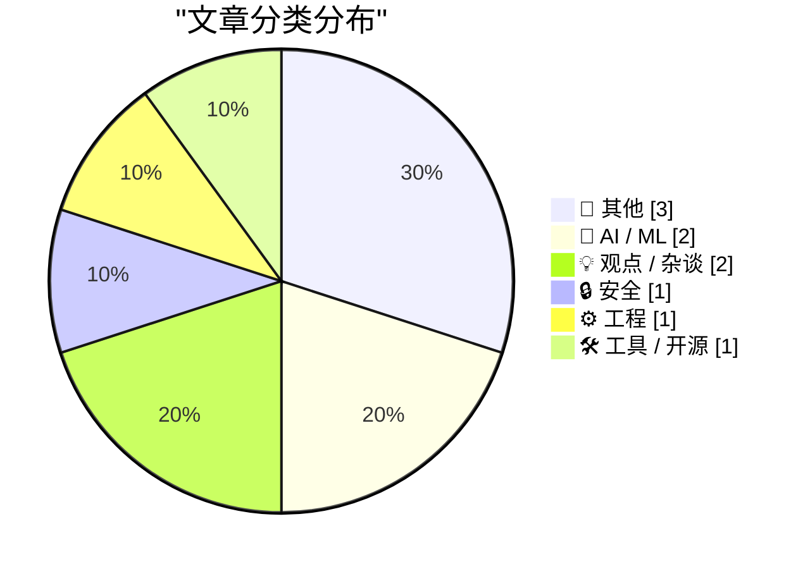
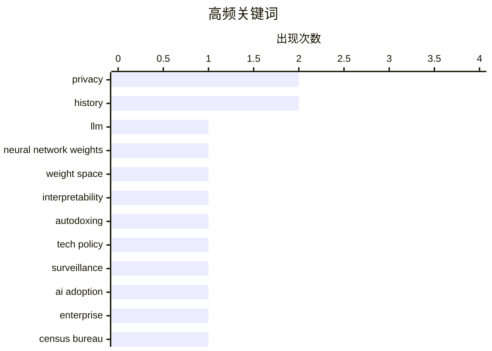

# 📰 AI 博客每日精选

**日期**: 2026-11-03 &nbsp;|&nbsp; **精选**: 10 篇 &nbsp;|&nbsp; **时间范围**: 24 小时

> 📚 来自 Karpathy 推荐的 **92** 个顶级技术博客，经 AI 智能评分筛选

## 📑 目录

- [📝 今日看点](#-今日看点)
- [🏆 今日必读](#-今日必读)
- [📊 数据概览](#-数据概览)
- [📝 其他](#-其他) (3篇)
- [🤖 AI / ML](#-ai---ml) (2篇)
- [💡 观点 / 杂谈](#-观点---杂谈) (2篇)
- [🔒 安全](#-安全) (1篇)
- [⚙️ 工程](#-工程) (1篇)
- [🛠 工具 / 开源](#-工具---开源) (1篇)

---

## 📝 今日看点

<div style="background: linear-gradient(135deg, #667eea 0%, #764ba2 100%); padding: 16px 20px; border-radius: 12px; color: white; margin: 20px 0;">

今日技术圈的核心争议围绕AI能力的真实边界展开：一边是对LLM"超人"叙事的冷静拆解，另一边是AI数据分析在现实统计中的翻车案例，提醒人们对技术宣传保持审慎。与此同时，身份验证与数据收集的隐忧持续发酵，从年龄验证政策到自动人肉搜索，隐私与监控的张力成为政策讨论的焦点。另一个值得关注的暗线是技术环境对人的反向塑造——无论是被互动指标绑架的写作者，还是在生产环境冒险的工程师，都折射出效率至上文化下的系统性风险。

</div>

---

## 🏆 今日必读

### 🥇 [LLM在读写神经网络权重方面并非超人](https://seangoedecke.com/llms-are-not-superhuman-at-reading-and-writing-neural-network-weights/)

<div style="display: flex; gap: 16px; flex-wrap: wrap; margin: 12px 0; font-size: 14px; color: #666;">
<span>📁 🤖 AI / ML</span>
<span>⏰ 1 分钟前</span>
<span>⭐ 评分 24/30</span>
</div>

<div style="background: #f8f9fa; border-left: 4px solid #667eea; padding: 16px 20px; border-radius: 8px; margin: 16px 0;">

针对近期一篇声称前沿LLM能直接操作神经网络权重的论文，作者指出这种能力看似超人实则不然。论文称GPT-6 Astra能直接与小型网络的权重交互，识别网络训练所用的游戏，表现超出人类或传统算法的预期。作者认为这并非真正的超人能力，而是因为小型网络的权重空间信息量有限，LLM可以借助训练数据中的模式识别来推断。结论是LLM在权重层面的"理解"被夸大，不应据此认为其具备超越人类的神经网络分析能力。

</div>

**💡 为什么值得读**: 对AI能力炒作保持警惕的读者会喜欢这篇冷静拆解"超人"说法的短文。

**🏷️ 标签**: <span style="display:inline-block;background:#e3f2fd;color:#1976D2;padding:4px 12px;border-radius:16px;font-size:12px;margin-right:6px;">LLM</span><span style="display:inline-block;background:#e3f2fd;color:#1976D2;padding:4px 12px;border-radius:16px;font-size:12px;margin-right:6px;">neural network weights</span><span style="display:inline-block;background:#e3f2fd;color:#1976D2;padding:4px 12px;border-radius:16px;font-size:12px;margin-right:6px;">weight space</span><span style="display:inline-block;background:#e3f2fd;color:#1976D2;padding:4px 12px;border-radius:16px;font-size:12px;margin-right:6px;">interpretability</span>

---

### 🥈 [Pluralistic：自动人肉搜索（2026年11月2日）](https://pluralistic.net/2026/11/02/agony-verification/)

<div style="display: flex; gap: 16px; flex-wrap: wrap; margin: 12px 0; font-size: 14px; color: #666;">
<span>📁 🔒 安全</span>
<span>⏰ 15 小时前</span>
<span>⭐ 评分 22/30</span>
</div>

<div style="background: #f8f9fa; border-left: 4px solid #667eea; padding: 16px 20px; border-radius: 8px; margin: 16px 0;">

本期Pluralistic专栏以"Autodoxing"（自动人肉搜索）为主题，批评考虑不周的技术政策如何铺就通往地狱之路。文章指出，为验证年龄而强制收集身份信息的政策，实际上为数据经纪商和监控机构创造了大规模收集个人数据的动机与渠道。作者还列举了多个链接话题，包括莎士比亚编程语言、DeCSS被视为"纯言论"、Blue Coat向叙利亚秘密警察出售监控工具、以及有线电视价格20年涨幅达通胀两倍等。核心观点是：以保护儿童为名的年龄验证立法，可能带来比问题本身更严重的隐私与监控后果。

</div>

**💡 为什么值得读**: 想了解年龄验证立法背后隐私代价的读者，能从这篇犀利的技术政策评论中获得警示。

**🏷️ 标签**: <span style="display:inline-block;background:#e3f2fd;color:#1976D2;padding:4px 12px;border-radius:16px;font-size:12px;margin-right:6px;">autodoxing</span><span style="display:inline-block;background:#e3f2fd;color:#1976D2;padding:4px 12px;border-radius:16px;font-size:12px;margin-right:6px;">tech policy</span><span style="display:inline-block;background:#e3f2fd;color:#1976D2;padding:4px 12px;border-radius:16px;font-size:12px;margin-right:6px;">surveillance</span><span style="display:inline-block;background:#e3f2fd;color:#1976D2;padding:4px 12px;border-radius:16px;font-size:12px;margin-right:6px;">privacy</span>

---

### 🥉 [美国人口普查局与"超级智能"](https://simonwillison.net/2026/Nov/2/census-bureau-super-intelligence/)

<div style="display: flex; gap: 16px; flex-wrap: wrap; margin: 12px 0; font-size: 14px; color: #666;">
<span>📁 🤖 AI / ML</span>
<span>⏰ 10 小时前</span>
<span>⭐ 评分 21/30</span>
</div>

<div style="background: #f8f9fa; border-left: 4px solid #667eea; padding: 16px 20px; border-radius: 8px; margin: 16px 0;">

文章回顾了Apollo Global Management于2025年9月发布的一张图表，该图基于美国人口普查局数据，显示美国大型企业的AI采用率呈下降趋势。作者当时用这张图演示GPT-5的数据分析能力，但如今重新审视发现，图表所依据的普查数据本身存在方法论问题，可能误导了对AI采用趋势的判断。文章借此说明，即便是权威机构的数据，在缺乏上下文时也可能被误读，而LLM在分析此类数据时同样需要谨慎对待数据来源与统计口径。结论是应警惕用单一图表断言AI采用趋势，需回到原始数据核实。

</div>

**💡 为什么值得读**: 对AI采用率数据和LLM数据分析可靠性感兴趣的读者，会从这次"回头看"中获得方法论启发。

**🏷️ 标签**: <span style="display:inline-block;background:#e3f2fd;color:#1976D2;padding:4px 12px;border-radius:16px;font-size:12px;margin-right:6px;">AI adoption</span><span style="display:inline-block;background:#e3f2fd;color:#1976D2;padding:4px 12px;border-radius:16px;font-size:12px;margin-right:6px;">enterprise</span><span style="display:inline-block;background:#e3f2fd;color:#1976D2;padding:4px 12px;border-radius:16px;font-size:12px;margin-right:6px;">Census Bureau</span><span style="display:inline-block;background:#e3f2fd;color:#1976D2;padding:4px 12px;border-radius:16px;font-size:12px;margin-right:6px;">superintelligence</span>

---

## 📊 数据概览

<div style="display: grid; grid-template-columns: repeat(auto-fit, minmax(120px, 1fr)); gap: 12px; margin: 20px 0;">
<div style="background: #e8f4f8; padding: 16px; border-radius: 10px; text-align: center;">
<div style="font-size: 24px; font-weight: bold; color: #2196F3;">87/92</div>
<div style="font-size: 13px; color: #666; margin-top: 4px;">扫描源</div>
</div>
<div style="background: #fff3e0; padding: 16px; border-radius: 10px; text-align: center;">
<div style="font-size: 24px; font-weight: bold; color: #FF9800;">2640</div>
<div style="font-size: 13px; color: #666; margin-top: 4px;">抓取文章</div>
</div>
<div style="background: #f3e5f5; padding: 16px; border-radius: 10px; text-align: center;">
<div style="font-size: 24px; font-weight: bold; color: #9C27B0;">10</div>
<div style="font-size: 13px; color: #666; margin-top: 4px;">时间范围内</div>
</div>
<div style="background: #e8f5e9; padding: 16px; border-radius: 10px; text-align: center;">
<div style="font-size: 24px; font-weight: bold; color: #4CAF50;">10</div>
<div style="font-size: 13px; color: #666; margin-top: 4px;">AI 精选</div>
</div>
</div>

### 🥧 分类分布



### 📈 高频关键词



<details style="margin: 16px 0; padding: 12px; background: #f5f5f5; border-radius: 8px;">
<summary style="cursor: pointer; font-weight: 500;">📊 纯文本关键词图（终端友好）</summary>

```
privacy                │ ████████████████████ 2
history                │ ████████████████████ 2
llm                    │ ██████████░░░░░░░░░░ 1
neural network weights │ ██████████░░░░░░░░░░ 1
weight space           │ ██████████░░░░░░░░░░ 1
interpretability       │ ██████████░░░░░░░░░░ 1
autodoxing             │ ██████████░░░░░░░░░░ 1
tech policy            │ ██████████░░░░░░░░░░ 1
surveillance           │ ██████████░░░░░░░░░░ 1
ai adoption            │ ██████████░░░░░░░░░░ 1
```

</details>

### 🏷️ 话题标签

<div style="line-height: 2; margin: 16px 0;">
**privacy**(2) · **history**(2) · **llm**(1) · neural network weights(1) · weight space(1) · interpretability(1) · autodoxing(1) · tech policy(1) · surveillance(1) · ai adoption(1) · enterprise(1) · census bureau(1) · superintelligence(1) · age verification(1) · social media(1) · regulation(1) · audience capture(1) · writing(1) · metrics(1) · career(1)
</div>

---

<a id="-其他"></a>
## 📝 其他 <span style="background: #e0e0e0; padding: 2px 10px; border-radius: 12px; font-size: 13px; margin-left: 8px;">3篇</span>

### 1. [与射影平面和解](https://www.johndcook.com/blog/2026/11/02/projective-plane/)

<div style="margin: 10px 0;">
<div style="display: flex; justify-content: space-between; font-size: 13px; margin-bottom: 4px;">
<span>⭐ 综合评分</span>
<span style="font-weight: bold; color: #f44336;">13/30</span>
</div>
<div style="background: #e0e0e0; height: 8px; border-radius: 4px; overflow: hidden;">
<div style="background: #f44336; width: 43%; height: 100%; border-radius: 4px;"></div>
</div>
</div>

<div style="display: flex; gap: 12px; flex-wrap: wrap; font-size: 13px; color: #666; margin: 12px 0;">
<span>📁 johndcook.com</span>
<span>⏰ 9 小时前</span>
<span>🔖 R:4 Q:6 T:3</span>
</div>

<div style="background: #fafafa; border-radius: 8px; padding: 16px; margin: 12px 0; line-height: 1.7;">
作者回忆学生时代觉得射影空间和齐次坐标是缺乏动机的任意抽象，因为课堂上只讲定义不讲来由。多年后他意识到这些概念其实自然且几乎不可避免，只是当初的教学方式掩盖了其动机。文章在其通讯中为近期几篇相关文章提供导览和补充评论，串联起射影几何的学习心路。核心观点是：数学抽象之所以显得任意，往往是因为缺少动机铺垫，而非概念本身不自然。
</div>

<div style="margin: 12px 0;">
<span style="display: inline-block; background: #e3f2fd; color: #1976D2; padding: 4px 12px; border-radius: 16px; font-size: 12px; margin-right: 6px; margin-bottom: 4px;">projective plane</span><span style="display: inline-block; background: #e3f2fd; color: #1976D2; padding: 4px 12px; border-radius: 16px; font-size: 12px; margin-right: 6px; margin-bottom: 4px;">mathematics</span><span style="display: inline-block; background: #e3f2fd; color: #1976D2; padding: 4px 12px; border-radius: 16px; font-size: 12px; margin-right: 6px; margin-bottom: 4px;">geometry</span><span style="display: inline-block; background: #e3f2fd; color: #1976D2; padding: 4px 12px; border-radius: 16px; font-size: 12px; margin-right: 6px; margin-bottom: 4px;">coordinates</span>
</div>

---

### 2. [溜进礼堂看Windows 2000发布彩排](https://devblogs.microsoft.com/oldnewthing/20261102-00/?p=112818/)

<div style="margin: 10px 0;">
<div style="display: flex; justify-content: space-between; font-size: 13px; margin-bottom: 4px;">
<span>⭐ 综合评分</span>
<span style="font-weight: bold; color: #f44336;">12/30</span>
</div>
<div style="background: #e0e0e0; height: 8px; border-radius: 4px; overflow: hidden;">
<div style="background: #f44336; width: 40%; height: 100%; border-radius: 4px;"></div>
</div>
</div>

<div style="display: flex; gap: 12px; flex-wrap: wrap; font-size: 13px; color: #666; margin: 12px 0;">
<span>📁 devblogs.microsoft.com/oldnewthing</span>
<span>⏰ 9 小时前</span>
<span>🔖 R:4 Q:5 T:3</span>
</div>

<div style="background: #fafafa; border-radius: 8px; padding: 16px; margin: 12px 0; line-height: 1.7;">
这是"Old New Thing"专栏的一篇回忆短文，讲述作者当年混进礼堂观看Windows 2000发布彩排的经历。文章以"等等，那不是他"的悬念开场，暗示彩排现场出现了意料之外的人物或状况。作为Raymond Chen式的微软内部轶事，短文以轻松笔触还原了大型产品发布前的幕后氛围。核心是一则关于大公司发布彩排的趣味回忆，细节留待读者点进原文揭晓。
</div>

<div style="margin: 12px 0;">
<span style="display: inline-block; background: #e3f2fd; color: #1976D2; padding: 4px 12px; border-radius: 16px; font-size: 12px; margin-right: 6px; margin-bottom: 4px;">Windows 2000</span><span style="display: inline-block; background: #e3f2fd; color: #1976D2; padding: 4px 12px; border-radius: 16px; font-size: 12px; margin-right: 6px; margin-bottom: 4px;">Microsoft</span><span style="display: inline-block; background: #e3f2fd; color: #1976D2; padding: 4px 12px; border-radius: 16px; font-size: 12px; margin-right: 6px; margin-bottom: 4px;">history</span><span style="display: inline-block; background: #e3f2fd; color: #1976D2; padding: 4px 12px; border-radius: 16px; font-size: 12px; margin-right: 6px; margin-bottom: 4px;">launch</span>
</div>

---

### 3. [Etoys.com的迅速崛起与陨落](https://dfarq.homeip.net/etoys-com-and-its-rapid-rise-and-fall/?utm_source=rss&#038;utm_medium=rss&#038;utm_campaign=etoys-com-and-its-rapid-rise-and-fall)

<div style="margin: 10px 0;">
<div style="display: flex; justify-content: space-between; font-size: 13px; margin-bottom: 4px;">
<span>⭐ 综合评分</span>
<span style="font-weight: bold; color: #f44336;">12/30</span>
</div>
<div style="background: #e0e0e0; height: 8px; border-radius: 4px; overflow: hidden;">
<div style="background: #f44336; width: 40%; height: 100%; border-radius: 4px;"></div>
</div>
</div>

<div style="display: flex; gap: 12px; flex-wrap: wrap; font-size: 13px; color: #666; margin: 12px 0;">
<span>📁 dfarq.homeip.net</span>
<span>⏰ 12 小时前</span>
<span>🔖 R:4 Q:5 T:3</span>
</div>

<div style="background: #fafafa; border-radius: 8px; padding: 16px; margin: 12px 0; line-height: 1.7;">
故事回到1997年11月，互联网方兴未艾，有人想创办在线生意，点子是在网上卖玩具——于是有了短命的Etoys.com。文章讲述这家玩具电商如何在互联网热潮中迅速崛起，又同样迅速地走向衰败。作为早期 dot-com 泡沫的典型案例，Etoys 的兴衰折射出那个时代对在线零售的乐观预期与现实的落差。核心是回顾一家曾被看好的互联网玩具零售商为何未能存活。
</div>

<div style="margin: 12px 0;">
<span style="display: inline-block; background: #e3f2fd; color: #1976D2; padding: 4px 12px; border-radius: 16px; font-size: 12px; margin-right: 6px; margin-bottom: 4px;">e-commerce</span><span style="display: inline-block; background: #e3f2fd; color: #1976D2; padding: 4px 12px; border-radius: 16px; font-size: 12px; margin-right: 6px; margin-bottom: 4px;">dot-com</span><span style="display: inline-block; background: #e3f2fd; color: #1976D2; padding: 4px 12px; border-radius: 16px; font-size: 12px; margin-right: 6px; margin-bottom: 4px;">history</span><span style="display: inline-block; background: #e3f2fd; color: #1976D2; padding: 4px 12px; border-radius: 16px; font-size: 12px; margin-right: 6px; margin-bottom: 4px;">Etoys</span>
</div>

---

<a id="-ai---ml"></a>
## 🤖 AI / ML <span style="background: #e0e0e0; padding: 2px 10px; border-radius: 12px; font-size: 13px; margin-left: 8px;">2篇</span>

### 4. [LLM在读写神经网络权重方面并非超人](https://seangoedecke.com/llms-are-not-superhuman-at-reading-and-writing-neural-network-weights/)

<div style="margin: 10px 0;">
<div style="display: flex; justify-content: space-between; font-size: 13px; margin-bottom: 4px;">
<span>⭐ 综合评分</span>
<span style="font-weight: bold; color: #4CAF50;">24/30</span>
</div>
<div style="background: #e0e0e0; height: 8px; border-radius: 4px; overflow: hidden;">
<div style="background: #4CAF50; width: 80%; height: 100%; border-radius: 4px;"></div>
</div>
</div>

<div style="display: flex; gap: 12px; flex-wrap: wrap; font-size: 13px; color: #666; margin: 12px 0;">
<span>📁 seangoedecke.com</span>
<span>⏰ 1 分钟前</span>
<span>🔖 R:8 Q:8 T:8</span>
</div>

<div style="background: #fafafa; border-radius: 8px; padding: 16px; margin: 12px 0; line-height: 1.7;">
针对近期一篇声称前沿LLM能直接操作神经网络权重的论文，作者指出这种能力看似超人实则不然。论文称GPT-6 Astra能直接与小型网络的权重交互，识别网络训练所用的游戏，表现超出人类或传统算法的预期。作者认为这并非真正的超人能力，而是因为小型网络的权重空间信息量有限，LLM可以借助训练数据中的模式识别来推断。结论是LLM在权重层面的"理解"被夸大，不应据此认为其具备超越人类的神经网络分析能力。
</div>

<div style="margin: 12px 0;">
<span style="display: inline-block; background: #e3f2fd; color: #1976D2; padding: 4px 12px; border-radius: 16px; font-size: 12px; margin-right: 6px; margin-bottom: 4px;">LLM</span><span style="display: inline-block; background: #e3f2fd; color: #1976D2; padding: 4px 12px; border-radius: 16px; font-size: 12px; margin-right: 6px; margin-bottom: 4px;">neural network weights</span><span style="display: inline-block; background: #e3f2fd; color: #1976D2; padding: 4px 12px; border-radius: 16px; font-size: 12px; margin-right: 6px; margin-bottom: 4px;">weight space</span><span style="display: inline-block; background: #e3f2fd; color: #1976D2; padding: 4px 12px; border-radius: 16px; font-size: 12px; margin-right: 6px; margin-bottom: 4px;">interpretability</span>
</div>

---

### 5. [美国人口普查局与"超级智能"](https://simonwillison.net/2026/Nov/2/census-bureau-super-intelligence/)

<div style="margin: 10px 0;">
<div style="display: flex; justify-content: space-between; font-size: 13px; margin-bottom: 4px;">
<span>⭐ 综合评分</span>
<span style="font-weight: bold; color: #FF9800;">21/30</span>
</div>
<div style="background: #e0e0e0; height: 8px; border-radius: 4px; overflow: hidden;">
<div style="background: #FF9800; width: 70%; height: 100%; border-radius: 4px;"></div>
</div>
</div>

<div style="display: flex; gap: 12px; flex-wrap: wrap; font-size: 13px; color: #666; margin: 12px 0;">
<span>📁 simonwillison.net</span>
<span>⏰ 10 小时前</span>
<span>🔖 R:7 Q:6 T:8</span>
</div>

<div style="background: #fafafa; border-radius: 8px; padding: 16px; margin: 12px 0; line-height: 1.7;">
文章回顾了Apollo Global Management于2025年9月发布的一张图表，该图基于美国人口普查局数据，显示美国大型企业的AI采用率呈下降趋势。作者当时用这张图演示GPT-5的数据分析能力，但如今重新审视发现，图表所依据的普查数据本身存在方法论问题，可能误导了对AI采用趋势的判断。文章借此说明，即便是权威机构的数据，在缺乏上下文时也可能被误读，而LLM在分析此类数据时同样需要谨慎对待数据来源与统计口径。结论是应警惕用单一图表断言AI采用趋势，需回到原始数据核实。
</div>

<div style="margin: 12px 0;">
<span style="display: inline-block; background: #e3f2fd; color: #1976D2; padding: 4px 12px; border-radius: 16px; font-size: 12px; margin-right: 6px; margin-bottom: 4px;">AI adoption</span><span style="display: inline-block; background: #e3f2fd; color: #1976D2; padding: 4px 12px; border-radius: 16px; font-size: 12px; margin-right: 6px; margin-bottom: 4px;">enterprise</span><span style="display: inline-block; background: #e3f2fd; color: #1976D2; padding: 4px 12px; border-radius: 16px; font-size: 12px; margin-right: 6px; margin-bottom: 4px;">Census Bureau</span><span style="display: inline-block; background: #e3f2fd; color: #1976D2; padding: 4px 12px; border-radius: 16px; font-size: 12px; margin-right: 6px; margin-bottom: 4px;">superintelligence</span>
</div>

---

<a id="-观点---杂谈"></a>
## 💡 观点 / 杂谈 <span style="background: #e0e0e0; padding: 2px 10px; border-radius: 12px; font-size: 13px; margin-left: 8px;">2篇</span>

### 6. [证明你不是小孩](https://idiallo.com/blog/prove-you-are-not-a-child)

<div style="margin: 10px 0;">
<div style="display: flex; justify-content: space-between; font-size: 13px; margin-bottom: 4px;">
<span>⭐ 综合评分</span>
<span style="font-weight: bold; color: #FF9800;">19/30</span>
</div>
<div style="background: #e0e0e0; height: 8px; border-radius: 4px; overflow: hidden;">
<div style="background: #FF9800; width: 63%; height: 100%; border-radius: 4px;"></div>
</div>
</div>

<div style="display: flex; gap: 12px; flex-wrap: wrap; font-size: 13px; color: #666; margin: 12px 0;">
<span>📁 idiallo.com</span>
<span>⏰ 1 分钟前</span>
<span>🔖 R:6 Q:6 T:7</span>
</div>

<div style="background: #fafafa; border-radius: 8px; padding: 16px; margin: 12px 0; line-height: 1.7;">
作者支持禁止儿童使用社交媒体，甚至主张按当前形态全面禁止，但反对现有的执行方式。核心问题在于：要针对不同群体实施禁令，就必须区分用户身份，而在信息和个人数据即是一切的时代，众多机构正觊觎这些数据。文章指出，年龄验证机制会催生大规模身份数据收集，带来隐私泄露和监控风险，其危害可能超过社交媒体本身对儿童的影响。结论是：禁令的目标或许正当，但以收集身份数据为前提的执行手段不可接受。
</div>

<div style="margin: 12px 0;">
<span style="display: inline-block; background: #e3f2fd; color: #1976D2; padding: 4px 12px; border-radius: 16px; font-size: 12px; margin-right: 6px; margin-bottom: 4px;">age verification</span><span style="display: inline-block; background: #e3f2fd; color: #1976D2; padding: 4px 12px; border-radius: 16px; font-size: 12px; margin-right: 6px; margin-bottom: 4px;">social media</span><span style="display: inline-block; background: #e3f2fd; color: #1976D2; padding: 4px 12px; border-radius: 16px; font-size: 12px; margin-right: 6px; margin-bottom: 4px;">privacy</span><span style="display: inline-block; background: #e3f2fd; color: #1976D2; padding: 4px 12px; border-radius: 16px; font-size: 12px; margin-right: 6px; margin-bottom: 4px;">regulation</span>
</div>

---

### 7. [受众俘获](https://seangoedecke.com/audience-capture/)

<div style="margin: 10px 0;">
<div style="display: flex; justify-content: space-between; font-size: 13px; margin-bottom: 4px;">
<span>⭐ 综合评分</span>
<span style="font-weight: bold; color: #FF9800;">18/30</span>
</div>
<div style="background: #e0e0e0; height: 8px; border-radius: 4px; overflow: hidden;">
<div style="background: #FF9800; width: 60%; height: 100%; border-radius: 4px;"></div>
</div>
</div>

<div style="display: flex; gap: 12px; flex-wrap: wrap; font-size: 13px; color: #666; margin: 12px 0;">
<span>📁 seangoedecke.com</span>
<span>⏰ 1 分钟前</span>
<span>🔖 R:6 Q:7 T:5</span>
</div>

<div style="background: #fafafa; border-radius: 8px; padding: 16px; margin: 12px 0; line-height: 1.7;">
作者坦言，在网上写作最令他恐惧的是"受众俘获"——即被读者反馈和互动指标反向塑造。他自认有工程师的灵魂，看到engagement这类指标就想把它做高，而整个在线写作环境恰恰为此量身定制，让人轻易找到提升数字的方法。文章探讨了这种机制如何逐步改变写作者的选题、观点和表达，最终使内容迎合受众而非忠于本意。核心观点是：写作者必须警惕指标驱动的诱惑，否则会在不知不觉中失去自己的声音。
</div>

<div style="margin: 12px 0;">
<span style="display: inline-block; background: #e3f2fd; color: #1976D2; padding: 4px 12px; border-radius: 16px; font-size: 12px; margin-right: 6px; margin-bottom: 4px;">audience capture</span><span style="display: inline-block; background: #e3f2fd; color: #1976D2; padding: 4px 12px; border-radius: 16px; font-size: 12px; margin-right: 6px; margin-bottom: 4px;">writing</span><span style="display: inline-block; background: #e3f2fd; color: #1976D2; padding: 4px 12px; border-radius: 16px; font-size: 12px; margin-right: 6px; margin-bottom: 4px;">metrics</span><span style="display: inline-block; background: #e3f2fd; color: #1976D2; padding: 4px 12px; border-radius: 16px; font-size: 12px; margin-right: 6px; margin-bottom: 4px;">career</span>
</div>

---

<a id="-安全"></a>
## 🔒 安全 <span style="background: #e0e0e0; padding: 2px 10px; border-radius: 12px; font-size: 13px; margin-left: 8px;">1篇</span>

### 8. [Pluralistic：自动人肉搜索（2026年11月2日）](https://pluralistic.net/2026/11/02/agony-verification/)

<div style="margin: 10px 0;">
<div style="display: flex; justify-content: space-between; font-size: 13px; margin-bottom: 4px;">
<span>⭐ 综合评分</span>
<span style="font-weight: bold; color: #FF9800;">22/30</span>
</div>
<div style="background: #e0e0e0; height: 8px; border-radius: 4px; overflow: hidden;">
<div style="background: #FF9800; width: 73%; height: 100%; border-radius: 4px;"></div>
</div>
</div>

<div style="display: flex; gap: 12px; flex-wrap: wrap; font-size: 13px; color: #666; margin: 12px 0;">
<span>📁 pluralistic.net</span>
<span>⏰ 15 小时前</span>
<span>🔖 R:7 Q:7 T:8</span>
</div>

<div style="background: #fafafa; border-radius: 8px; padding: 16px; margin: 12px 0; line-height: 1.7;">
本期Pluralistic专栏以"Autodoxing"（自动人肉搜索）为主题，批评考虑不周的技术政策如何铺就通往地狱之路。文章指出，为验证年龄而强制收集身份信息的政策，实际上为数据经纪商和监控机构创造了大规模收集个人数据的动机与渠道。作者还列举了多个链接话题，包括莎士比亚编程语言、DeCSS被视为"纯言论"、Blue Coat向叙利亚秘密警察出售监控工具、以及有线电视价格20年涨幅达通胀两倍等。核心观点是：以保护儿童为名的年龄验证立法，可能带来比问题本身更严重的隐私与监控后果。
</div>

<div style="margin: 12px 0;">
<span style="display: inline-block; background: #e3f2fd; color: #1976D2; padding: 4px 12px; border-radius: 16px; font-size: 12px; margin-right: 6px; margin-bottom: 4px;">autodoxing</span><span style="display: inline-block; background: #e3f2fd; color: #1976D2; padding: 4px 12px; border-radius: 16px; font-size: 12px; margin-right: 6px; margin-bottom: 4px;">tech policy</span><span style="display: inline-block; background: #e3f2fd; color: #1976D2; padding: 4px 12px; border-radius: 16px; font-size: 12px; margin-right: 6px; margin-bottom: 4px;">surveillance</span><span style="display: inline-block; background: #e3f2fd; color: #1976D2; padding: 4px 12px; border-radius: 16px; font-size: 12px; margin-right: 6px; margin-bottom: 4px;">privacy</span>
</div>

---

<a id="-工程"></a>
## ⚙️ 工程 <span style="background: #e0e0e0; padding: 2px 10px; border-radius: 12px; font-size: 13px; margin-left: 8px;">1篇</span>

### 9. [Lorem Ipsum 点 Gov 点 UK](https://shkspr.mobi/blog/2026/11/lorem-ipsum-dot-gov-dot-uk/)

<div style="margin: 10px 0;">
<div style="display: flex; justify-content: space-between; font-size: 13px; margin-bottom: 4px;">
<span>⭐ 综合评分</span>
<span style="font-weight: bold; color: #f44336;">14/30</span>
</div>
<div style="background: #e0e0e0; height: 8px; border-radius: 4px; overflow: hidden;">
<div style="background: #f44336; width: 47%; height: 100%; border-radius: 4px;"></div>
</div>
</div>

<div style="display: flex; gap: 12px; flex-wrap: wrap; font-size: 13px; color: #666; margin: 12px 0;">
<span>📁 shkspr.mobi</span>
<span>⏰ 11 小时前</span>
<span>🔖 R:5 Q:5 T:4</span>
</div>

<div style="background: #fafafa; border-radius: 8px; padding: 16px; margin: 12px 0; line-height: 1.7;">
作者以调侃口吻讲述"在生产环境测试"的刺激体验——不小心发布占位数据或搞垮整个网站，如同无伞跳伞般惊险。文章指出，在新网站或服务上线前测试文本显示效果是明智之举，但多数人不用可读文本测试，因为管理层太容易对占位内容当真。于是Lorem Ipsum这类拉丁文占位符成了行业惯例，而英国政府网站域名下的占位文本更添一层荒诞感。核心观点是：占位文本的选择本身反映了组织流程中的现实约束与幽默。
</div>

<div style="margin: 12px 0;">
<span style="display: inline-block; background: #e3f2fd; color: #1976D2; padding: 4px 12px; border-radius: 16px; font-size: 12px; margin-right: 6px; margin-bottom: 4px;">testing</span><span style="display: inline-block; background: #e3f2fd; color: #1976D2; padding: 4px 12px; border-radius: 16px; font-size: 12px; margin-right: 6px; margin-bottom: 4px;">production</span><span style="display: inline-block; background: #e3f2fd; color: #1976D2; padding: 4px 12px; border-radius: 16px; font-size: 12px; margin-right: 6px; margin-bottom: 4px;">dummy data</span><span style="display: inline-block; background: #e3f2fd; color: #1976D2; padding: 4px 12px; border-radius: 16px; font-size: 12px; margin-right: 6px; margin-bottom: 4px;">web</span>
</div>

---

<a id="-工具---开源"></a>
## 🛠 工具 / 开源 <span style="background: #e0e0e0; padding: 2px 10px; border-radius: 12px; font-size: 13px; margin-left: 8px;">1篇</span>

### 10. [赞助商：OurCal](https://ourcal.com/?utm_source=daringfireball&amp;utm_medium=sponsorship&amp;utm_content=rssitem)

<div style="margin: 10px 0;">
<div style="display: flex; justify-content: space-between; font-size: 13px; margin-bottom: 4px;">
<span>⭐ 综合评分</span>
<span style="font-weight: bold; color: #f44336;">13/30</span>
</div>
<div style="background: #e0e0e0; height: 8px; border-radius: 4px; overflow: hidden;">
<div style="background: #f44336; width: 43%; height: 100%; border-radius: 4px;"></div>
</div>
</div>

<div style="display: flex; gap: 12px; flex-wrap: wrap; font-size: 13px; color: #666; margin: 12px 0;">
<span>📁 daringfireball.net</span>
<span>⏰ 1 小时前</span>
<span>🔖 R:4 Q:4 T:5</span>
</div>

<div style="background: #fafafa; border-radius: 8px; padding: 16px; margin: 12px 0; line-height: 1.7;">
OurCal是一款解决"我没看到你写进日程"这一沟通问题的共享日历应用。它可将任意新旧日历连接到群聊，变更会自动发布到聊天中，确保无人错过。作为通讯工具，它实现了端到端加密，并获得法国网络安全机构认证。应用采用原生SwiftUI构建，覆盖Apple各平台，刚被App Store选入"iPhone Duo上的优秀应用"。核心卖点是：共享日历解决的是排期，而OurCal解决的是沟通。
</div>

<div style="margin: 12px 0;">
<span style="display: inline-block; background: #e3f2fd; color: #1976D2; padding: 4px 12px; border-radius: 16px; font-size: 12px; margin-right: 6px; margin-bottom: 4px;">calendar</span><span style="display: inline-block; background: #e3f2fd; color: #1976D2; padding: 4px 12px; border-radius: 16px; font-size: 12px; margin-right: 6px; margin-bottom: 4px;">encryption</span><span style="display: inline-block; background: #e3f2fd; color: #1976D2; padding: 4px 12px; border-radius: 16px; font-size: 12px; margin-right: 6px; margin-bottom: 4px;">group chat</span><span style="display: inline-block; background: #e3f2fd; color: #1976D2; padding: 4px 12px; border-radius: 16px; font-size: 12px; margin-right: 6px; margin-bottom: 4px;">scheduling</span>
</div>

---


<div style="text-align: center; color: #888; font-size: 13px; padding: 20px; border-top: 1px solid #e0e0e0; margin-top: 30px;">
生成于 2026-11-03 00:01 | 扫描 <strong>87</strong> 源 → 获取 <strong>2640</strong> 篇 → 精选 <strong>10</strong> 篇
<br>
基于 <a href="https://refactoringenglish.com/tools/hn-popularity/" style="color: #667eea;">Hacker News Popularity Contest 2025</a> RSS 源列表，由 <a href="https://x.com/karpathy" style="color: #667eea;">Andrej Karpathy</a> 推荐
<br>
由「懂点儿 AI」制作，欢迎关注同名微信公众号获取更多 AI 实用技巧 💡
</div>
