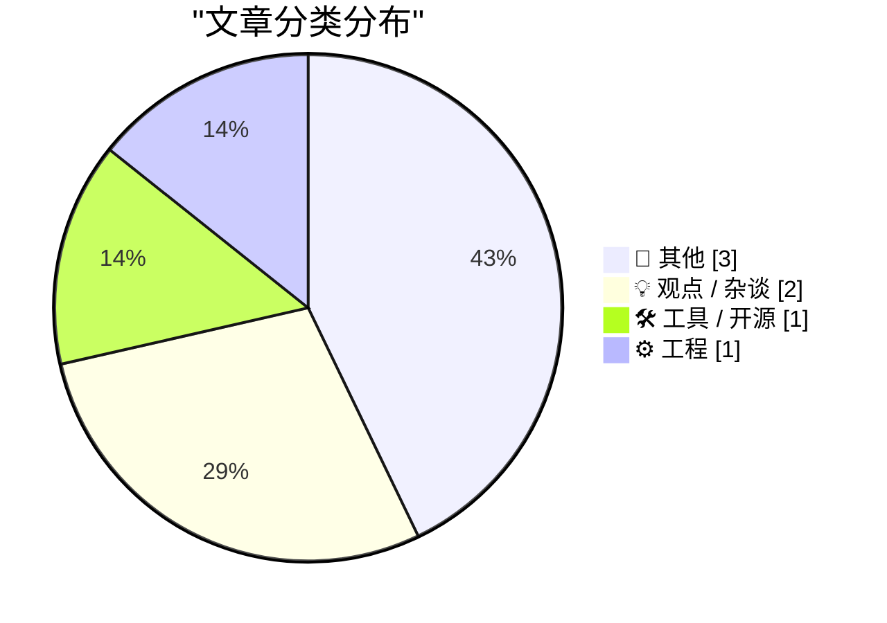
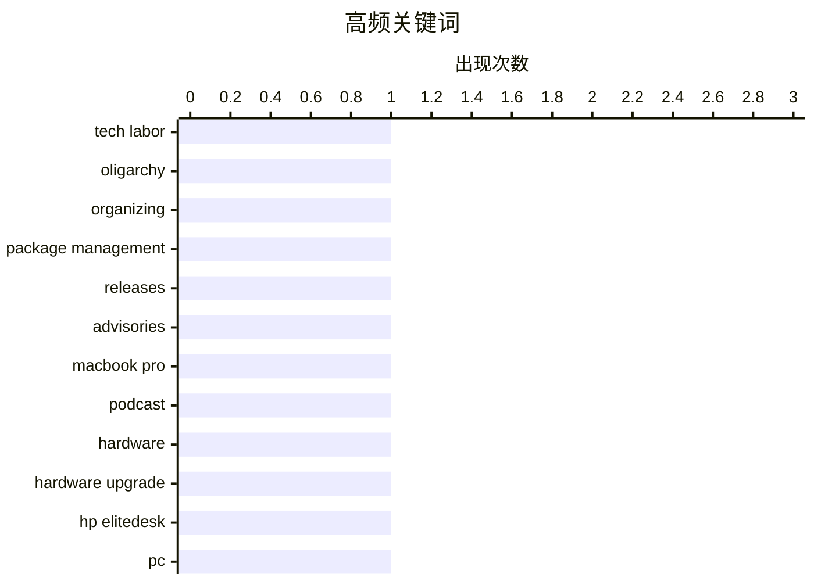

# 📰 AI 博客每日精选

**日期**: 2026-11-08 &nbsp;|&nbsp; **精选**: 7 篇 &nbsp;|&nbsp; **时间范围**: 24 小时

> 📚 来自 Karpathy 推荐的 **92** 个顶级技术博客，经 AI 智能评分筛选

## 📑 目录

- [📝 今日看点](#-今日看点)
- [🏆 今日必读](#-今日必读)
- [📊 数据概览](#-数据概览)
- [📝 其他](#-其他) (3篇)
- [💡 观点 / 杂谈](#-观点---杂谈) (2篇)
- [🛠 工具 / 开源](#-工具---开源) (1篇)
- [⚙️ 工程](#-工程) (1篇)

---

## 📝 今日看点

<div style="background: linear-gradient(135deg, #667eea 0%, #764ba2 100%); padding: 16px 20px; border-radius: 12px; color: white; margin: 20px 0;">

今日看点：科技劳工组织议题回潮，新书《反对科技寡头》呼吁为工程师、设计师等群体建立专属行动框架，折射行业权力结构正被重新审视。供应链与硬件生态同样暗流涌动，包管理器安全公告密集发布，PCB 短缺预警与二手商用机淘换攻略并存，显示开发者对底层基础设施的关注持续升温。与此同时，从灾难专家的个人叙事到复古火车套装的工艺考据，技术圈外的多元阅读趣味也在提醒我们：好内容从不局限于代码本身。

</div>

---

## 🏆 今日必读

### 🥇 [JS Tan 与 Clarissa Redwine 的《反对科技寡头》](https://pluralistic.net/2026/11/07/aeiou-but-sometimes-why/)

<div style="display: flex; gap: 16px; flex-wrap: wrap; margin: 12px 0; font-size: 14px; color: #666;">
<span>📁 💡 观点 / 杂谈</span>
<span>⏰ 10 小时前</span>
<span>⭐ 评分 23/30</span>
</div>

<div style="background: #f8f9fa; border-left: 4px solid #667eea; padding: 16px 20px; border-radius: 8px; margin: 16px 0;">

文章聚焦科技行业劳工组织问题，介绍 JS Tan 和 Clarissa Redwine 合著的《反对科技寡头》一书。该书主张为科技这一独特而强大的行业发明一套新的劳工行动手册，探索工程师、设计师等科技从业者如何通过集体行动对抗寡头化趋势。文章还汇总了 Gnutella 与 EMI 的旧案、股东至上如何让 Google 征服并'恶化'世界、以及'劳工的恶化'等关联话题。核心观点是科技从业者需要新的组织工具来应对行业权力集中。

</div>

**💡 为什么值得读**: 如果你关心科技行业权力结构与劳工运动，这篇书评式导读提供了理解科技寡头化与从业者反抗路径的新框架。

**🏷️ 标签**: <span style="display:inline-block;background:#e3f2fd;color:#1976D2;padding:4px 12px;border-radius:16px;font-size:12px;margin-right:6px;">tech labor</span><span style="display:inline-block;background:#e3f2fd;color:#1976D2;padding:4px 12px;border-radius:16px;font-size:12px;margin-right:6px;">oligarchy</span><span style="display:inline-block;background:#e3f2fd;color:#1976D2;padding:4px 12px;border-radius:16px;font-size:12px;margin-right:6px;">organizing</span>

---

### 🥈 [本周包管理动态：2026 年 11 月 7 日](https://nesbitt.io/2026/11/07/this-week-in-package-management.html)

<div style="display: flex; gap: 16px; flex-wrap: wrap; margin: 12px 0; font-size: 14px; color: #666;">
<span>📁 🛠 工具 / 开源</span>
<span>⏰ 14 小时前</span>
<span>⭐ 评分 23/30</span>
</div>

<div style="background: #f8f9fa; border-left: 4px solid #667eea; padding: 16px 20px; border-radius: 8px; margin: 16px 0;">

这是包管理领域的周期性汇总，覆盖各大包管理器与软件供应链生态的最新动态。内容包括新版本发布、安全公告（advisories）以及来自包管理世界的相关文章。适合快速了解 npm、PyPI、Cargo 等生态本周发生了什么。

</div>

**💡 为什么值得读**: 包管理与软件供应链从业者可借此一站式扫过本周发布、漏洞公告与社区讨论，省去逐个订阅源的麻烦。

**🏷️ 标签**: <span style="display:inline-block;background:#e3f2fd;color:#1976D2;padding:4px 12px;border-radius:16px;font-size:12px;margin-right:6px;">package management</span><span style="display:inline-block;background:#e3f2fd;color:#1976D2;padding:4px 12px;border-radius:16px;font-size:12px;margin-right:6px;">releases</span><span style="display:inline-block;background:#e3f2fd;color:#1976D2;padding:4px 12px;border-radius:16px;font-size:12px;margin-right:6px;">advisories</span>

---

### 🥉 [本人在 Full Stack Creator 谈配备 PROLED XDR 显示屏的新款 MacBook Pro](https://www.youtube.com/watch?v=f2GZtWuUPl0)

<div style="display: flex; gap: 16px; flex-wrap: wrap; margin: 12px 0; font-size: 14px; color: #666;">
<span>📁 💡 观点 / 杂谈</span>
<span>⏰ 2 小时前</span>
<span>⭐ 评分 18/30</span>
</div>

<div style="background: #f8f9fa; border-left: 4px solid #667eea; padding: 16px 20px; border-radius: 8px; margin: 16px 0;">

John Gruber 做客 Tyler Stalman 与 David Altizer 的 Full Stack Creator 播客，聊新款 MacBook Pro 及其 PROLED XDR 显示屏。他认为这批机器是'非常有趣的电脑'，也很值得一聊。节目中还顺带表达了对理光 GR 系列便携相机的喜爱，并提到他用 20 年前的初代 GR-D 拍摄了 2010 年 Steve Jobs 与 Walt Mossberg 的合影。

</div>

**💡 为什么值得读**: 想听 Gruber 对新款 MacBook Pro 显示屏的第一手评价，以及一段理光 GR 与乔布斯旧照的趣闻，这期播客值得一听。

**🏷️ 标签**: <span style="display:inline-block;background:#e3f2fd;color:#1976D2;padding:4px 12px;border-radius:16px;font-size:12px;margin-right:6px;">MacBook Pro</span><span style="display:inline-block;background:#e3f2fd;color:#1976D2;padding:4px 12px;border-radius:16px;font-size:12px;margin-right:6px;">podcast</span><span style="display:inline-block;background:#e3f2fd;color:#1976D2;padding:4px 12px;border-radius:16px;font-size:12px;margin-right:6px;">hardware</span>

---

## 📊 数据概览

<div style="display: grid; grid-template-columns: repeat(auto-fit, minmax(120px, 1fr)); gap: 12px; margin: 20px 0;">
<div style="background: #e8f4f8; padding: 16px; border-radius: 10px; text-align: center;">
<div style="font-size: 24px; font-weight: bold; color: #2196F3;">83/92</div>
<div style="font-size: 13px; color: #666; margin-top: 4px;">扫描源</div>
</div>
<div style="background: #fff3e0; padding: 16px; border-radius: 10px; text-align: center;">
<div style="font-size: 24px; font-weight: bold; color: #FF9800;">2590</div>
<div style="font-size: 13px; color: #666; margin-top: 4px;">抓取文章</div>
</div>
<div style="background: #f3e5f5; padding: 16px; border-radius: 10px; text-align: center;">
<div style="font-size: 24px; font-weight: bold; color: #9C27B0;">7</div>
<div style="font-size: 13px; color: #666; margin-top: 4px;">时间范围内</div>
</div>
<div style="background: #e8f5e9; padding: 16px; border-radius: 10px; text-align: center;">
<div style="font-size: 24px; font-weight: bold; color: #4CAF50;">7</div>
<div style="font-size: 13px; color: #666; margin-top: 4px;">AI 精选</div>
</div>
</div>

### 🥧 分类分布



### 📈 高频关键词



<details style="margin: 16px 0; padding: 12px; background: #f5f5f5; border-radius: 8px;">
<summary style="cursor: pointer; font-weight: 500;">📊 纯文本关键词图（终端友好）</summary>

```
tech labor         │ ████████████████████ 1
oligarchy          │ ████████████████████ 1
organizing         │ ████████████████████ 1
package management │ ████████████████████ 1
releases           │ ████████████████████ 1
advisories         │ ████████████████████ 1
macbook pro        │ ████████████████████ 1
podcast            │ ████████████████████ 1
hardware           │ ████████████████████ 1
hardware upgrade   │ ████████████████████ 1
```

</details>

### 🏷️ 话题标签

<div style="line-height: 2; margin: 16px 0;">
**tech labor**(1) · **oligarchy**(1) · **organizing**(1) · package management(1) · releases(1) · advisories(1) · macbook pro(1) · podcast(1) · hardware(1) · hardware upgrade(1) · hp elitedesk(1) · pc(1) · reading list(1) · infrastructure(1) · manufacturing(1) · book review(1) · disaster planning(1) · memoir(1) · model trains(1) · vintage toys(1)
</div>

---

<a id="-其他"></a>
## 📝 其他 <span style="background: #e0e0e0; padding: 2px 10px; border-radius: 12px; font-size: 13px; margin-left: 8px;">3篇</span>

### 1. [阅读清单 2026/11/7](https://www.construction-physics.com/p/reading-list-1172026)

<div style="margin: 10px 0;">
<div style="display: flex; justify-content: space-between; font-size: 13px; margin-bottom: 4px;">
<span>⭐ 综合评分</span>
<span style="font-weight: bold; color: #f44336;">16/30</span>
</div>
<div style="background: #e0e0e0; height: 8px; border-radius: 4px; overflow: hidden;">
<div style="background: #f44336; width: 53%; height: 100%; border-radius: 4px;"></div>
</div>
</div>

<div style="display: flex; gap: 12px; flex-wrap: wrap; font-size: 13px; color: #666; margin: 12px 0;">
<span>📁 construction-physics.com</span>
<span>⏰ 10 小时前</span>
<span>🔖 R:4 Q:5 T:7</span>
</div>

<div style="background: #fafafa; border-radius: 8px; padding: 16px; margin: 12px 0; line-height: 1.7;">
本期阅读清单汇总多条产业与基建动态：佛罗里达州房产税回滚、PCB（印刷电路板）预计短缺、特斯拉 Cybertruck 项目终结、碳封存进展停滞等。内容横跨房地产、电子供应链、汽车与气候技术。适合快速浏览本周值得关注的宏观与产业信号。
</div>

<div style="margin: 12px 0;">
<span style="display: inline-block; background: #e3f2fd; color: #1976D2; padding: 4px 12px; border-radius: 16px; font-size: 12px; margin-right: 6px; margin-bottom: 4px;">reading list</span><span style="display: inline-block; background: #e3f2fd; color: #1976D2; padding: 4px 12px; border-radius: 16px; font-size: 12px; margin-right: 6px; margin-bottom: 4px;">infrastructure</span><span style="display: inline-block; background: #e3f2fd; color: #1976D2; padding: 4px 12px; border-radius: 16px; font-size: 12px; margin-right: 6px; margin-bottom: 4px;">manufacturing</span>
</div>

---

### 2. [书评：《当尘埃落定》——一位灾难专家关于爱、失去与希望的故事，作者 Lucy Easthope ★★★★★](https://shkspr.mobi/blog/2026/11/book-review-when-the-dust-settles-stories-of-love-loss-and-hope-from-an-expert-in-disaster-by-lucy-easthope/)

<div style="margin: 10px 0;">
<div style="display: flex; justify-content: space-between; font-size: 13px; margin-bottom: 4px;">
<span>⭐ 综合评分</span>
<span style="font-weight: bold; color: #f44336;">12/30</span>
</div>
<div style="background: #e0e0e0; height: 8px; border-radius: 4px; overflow: hidden;">
<div style="background: #f44336; width: 40%; height: 100%; border-radius: 4px;"></div>
</div>
</div>

<div style="display: flex; gap: 12px; flex-wrap: wrap; font-size: 13px; color: #666; margin: 12px 0;">
<span>📁 shkspr.mobi</span>
<span>⏰ 11 小时前</span>
<span>🔖 R:2 Q:7 T:3</span>
</div>

<div style="background: #fafafa; border-radius: 8px; padding: 16px; margin: 12px 0; line-height: 1.7;">
书评给予五星评价，称这是一本'难读但必读'的书。作者起初对书中大量直白的自传式内容（爱情、灾难、健康问题、家庭琐事）感到不适，觉得打断了想读的灾难规划内容。但随着阅读深入，他意识到这种个人化叙事恰恰至关重要：灾难无论自然还是人为，都无法以冷静抽离的方式应对。
</div>

<div style="margin: 12px 0;">
<span style="display: inline-block; background: #e3f2fd; color: #1976D2; padding: 4px 12px; border-radius: 16px; font-size: 12px; margin-right: 6px; margin-bottom: 4px;">book review</span><span style="display: inline-block; background: #e3f2fd; color: #1976D2; padding: 4px 12px; border-radius: 16px; font-size: 12px; margin-right: 6px; margin-bottom: 4px;">disaster planning</span><span style="display: inline-block; background: #e3f2fd; color: #1976D2; padding: 4px 12px; border-radius: 16px; font-size: 12px; margin-right: 6px; margin-bottom: 4px;">memoir</span>
</div>

---

### 3. [Marx 柴油货运火车套装 9613](https://dfarq.homeip.net/marx-diesel-freight-train-set-9613/?utm_source=rss&#038;utm_medium=rss&#038;utm_campaign=marx-diesel-freight-train-set-9613)

<div style="margin: 10px 0;">
<div style="display: flex; justify-content: space-between; font-size: 13px; margin-bottom: 4px;">
<span>⭐ 综合评分</span>
<span style="font-weight: bold; color: #f44336;">8/30</span>
</div>
<div style="background: #e0e0e0; height: 8px; border-radius: 4px; overflow: hidden;">
<div style="background: #f44336; width: 27%; height: 100%; border-radius: 4px;"></div>
</div>
</div>

<div style="display: flex; gap: 12px; flex-wrap: wrap; font-size: 13px; color: #666; margin: 12px 0;">
<span>📁 dfarq.homeip.net</span>
<span>⏰ 12 小时前</span>
<span>🔖 R:1 Q:5 T:2</span>
</div>

<div style="background: #fafafa; border-radius: 8px; padding: 16px; margin: 12px 0; line-height: 1.7;">
介绍 Marx 柴油货运火车套装 9613，这是 1950 年代初的电动火车套装，由双柴油机车牵引 7 英寸货运车厢，通过 Montgomery Ward 销售。文章称其为战后马口铁平版印刷工艺的优秀范例，套装外观颇具吸引力。属于复古玩具收藏类内容。
</div>

<div style="margin: 12px 0;">
<span style="display: inline-block; background: #e3f2fd; color: #1976D2; padding: 4px 12px; border-radius: 16px; font-size: 12px; margin-right: 6px; margin-bottom: 4px;">model trains</span><span style="display: inline-block; background: #e3f2fd; color: #1976D2; padding: 4px 12px; border-radius: 16px; font-size: 12px; margin-right: 6px; margin-bottom: 4px;">vintage toys</span><span style="display: inline-block; background: #e3f2fd; color: #1976D2; padding: 4px 12px; border-radius: 16px; font-size: 12px; margin-right: 6px; margin-bottom: 4px;">lithography</span>
</div>

---

<a id="-观点---杂谈"></a>
## 💡 观点 / 杂谈 <span style="background: #e0e0e0; padding: 2px 10px; border-radius: 12px; font-size: 13px; margin-left: 8px;">2篇</span>

### 4. [JS Tan 与 Clarissa Redwine 的《反对科技寡头》](https://pluralistic.net/2026/11/07/aeiou-but-sometimes-why/)

<div style="margin: 10px 0;">
<div style="display: flex; justify-content: space-between; font-size: 13px; margin-bottom: 4px;">
<span>⭐ 综合评分</span>
<span style="font-weight: bold; color: #FF9800;">23/30</span>
</div>
<div style="background: #e0e0e0; height: 8px; border-radius: 4px; overflow: hidden;">
<div style="background: #FF9800; width: 77%; height: 100%; border-radius: 4px;"></div>
</div>
</div>

<div style="display: flex; gap: 12px; flex-wrap: wrap; font-size: 13px; color: #666; margin: 12px 0;">
<span>📁 pluralistic.net</span>
<span>⏰ 10 小时前</span>
<span>🔖 R:8 Q:8 T:7</span>
</div>

<div style="background: #fafafa; border-radius: 8px; padding: 16px; margin: 12px 0; line-height: 1.7;">
文章聚焦科技行业劳工组织问题，介绍 JS Tan 和 Clarissa Redwine 合著的《反对科技寡头》一书。该书主张为科技这一独特而强大的行业发明一套新的劳工行动手册，探索工程师、设计师等科技从业者如何通过集体行动对抗寡头化趋势。文章还汇总了 Gnutella 与 EMI 的旧案、股东至上如何让 Google 征服并'恶化'世界、以及'劳工的恶化'等关联话题。核心观点是科技从业者需要新的组织工具来应对行业权力集中。
</div>

<div style="margin: 12px 0;">
<span style="display: inline-block; background: #e3f2fd; color: #1976D2; padding: 4px 12px; border-radius: 16px; font-size: 12px; margin-right: 6px; margin-bottom: 4px;">tech labor</span><span style="display: inline-block; background: #e3f2fd; color: #1976D2; padding: 4px 12px; border-radius: 16px; font-size: 12px; margin-right: 6px; margin-bottom: 4px;">oligarchy</span><span style="display: inline-block; background: #e3f2fd; color: #1976D2; padding: 4px 12px; border-radius: 16px; font-size: 12px; margin-right: 6px; margin-bottom: 4px;">organizing</span>
</div>

---

### 5. [本人在 Full Stack Creator 谈配备 PROLED XDR 显示屏的新款 MacBook Pro](https://www.youtube.com/watch?v=f2GZtWuUPl0)

<div style="margin: 10px 0;">
<div style="display: flex; justify-content: space-between; font-size: 13px; margin-bottom: 4px;">
<span>⭐ 综合评分</span>
<span style="font-weight: bold; color: #FF9800;">18/30</span>
</div>
<div style="background: #e0e0e0; height: 8px; border-radius: 4px; overflow: hidden;">
<div style="background: #FF9800; width: 60%; height: 100%; border-radius: 4px;"></div>
</div>
</div>

<div style="display: flex; gap: 12px; flex-wrap: wrap; font-size: 13px; color: #666; margin: 12px 0;">
<span>📁 daringfireball.net</span>
<span>⏰ 2 小时前</span>
<span>🔖 R:5 Q:5 T:8</span>
</div>

<div style="background: #fafafa; border-radius: 8px; padding: 16px; margin: 12px 0; line-height: 1.7;">
John Gruber 做客 Tyler Stalman 与 David Altizer 的 Full Stack Creator 播客，聊新款 MacBook Pro 及其 PROLED XDR 显示屏。他认为这批机器是'非常有趣的电脑'，也很值得一聊。节目中还顺带表达了对理光 GR 系列便携相机的喜爱，并提到他用 20 年前的初代 GR-D 拍摄了 2010 年 Steve Jobs 与 Walt Mossberg 的合影。
</div>

<div style="margin: 12px 0;">
<span style="display: inline-block; background: #e3f2fd; color: #1976D2; padding: 4px 12px; border-radius: 16px; font-size: 12px; margin-right: 6px; margin-bottom: 4px;">MacBook Pro</span><span style="display: inline-block; background: #e3f2fd; color: #1976D2; padding: 4px 12px; border-radius: 16px; font-size: 12px; margin-right: 6px; margin-bottom: 4px;">podcast</span><span style="display: inline-block; background: #e3f2fd; color: #1976D2; padding: 4px 12px; border-radius: 16px; font-size: 12px; margin-right: 6px; margin-bottom: 4px;">hardware</span>
</div>

---

<a id="-工具---开源"></a>
## 🛠 工具 / 开源 <span style="background: #e0e0e0; padding: 2px 10px; border-radius: 12px; font-size: 13px; margin-left: 8px;">1篇</span>

### 6. [本周包管理动态：2026 年 11 月 7 日](https://nesbitt.io/2026/11/07/this-week-in-package-management.html)

<div style="margin: 10px 0;">
<div style="display: flex; justify-content: space-between; font-size: 13px; margin-bottom: 4px;">
<span>⭐ 综合评分</span>
<span style="font-weight: bold; color: #FF9800;">23/30</span>
</div>
<div style="background: #e0e0e0; height: 8px; border-radius: 4px; overflow: hidden;">
<div style="background: #FF9800; width: 77%; height: 100%; border-radius: 4px;"></div>
</div>
</div>

<div style="display: flex; gap: 12px; flex-wrap: wrap; font-size: 13px; color: #666; margin: 12px 0;">
<span>📁 nesbitt.io</span>
<span>⏰ 14 小时前</span>
<span>🔖 R:8 Q:6 T:9</span>
</div>

<div style="background: #fafafa; border-radius: 8px; padding: 16px; margin: 12px 0; line-height: 1.7;">
这是包管理领域的周期性汇总，覆盖各大包管理器与软件供应链生态的最新动态。内容包括新版本发布、安全公告（advisories）以及来自包管理世界的相关文章。适合快速了解 npm、PyPI、Cargo 等生态本周发生了什么。
</div>

<div style="margin: 12px 0;">
<span style="display: inline-block; background: #e3f2fd; color: #1976D2; padding: 4px 12px; border-radius: 16px; font-size: 12px; margin-right: 6px; margin-bottom: 4px;">package management</span><span style="display: inline-block; background: #e3f2fd; color: #1976D2; padding: 4px 12px; border-radius: 16px; font-size: 12px; margin-right: 6px; margin-bottom: 4px;">releases</span><span style="display: inline-block; background: #e3f2fd; color: #1976D2; padding: 4px 12px; border-radius: 16px; font-size: 12px; margin-right: 6px; margin-bottom: 4px;">advisories</span>
</div>

---

<a id="-工程"></a>
## ⚙️ 工程 <span style="background: #e0e0e0; padding: 2px 10px; border-radius: 12px; font-size: 13px; margin-left: 8px;">1篇</span>

### 7. [升级日记：HP Elitedesk 800 G4](https://dfarq.homeip.net/upgrade-diary-hp-elitedesk-800-g4/?utm_source=rss&#038;utm_medium=rss&#038;utm_campaign=upgrade-diary-hp-elitedesk-800-g4)

<div style="margin: 10px 0;">
<div style="display: flex; justify-content: space-between; font-size: 13px; margin-bottom: 4px;">
<span>⭐ 综合评分</span>
<span style="font-weight: bold; color: #f44336;">17/30</span>
</div>
<div style="background: #e0e0e0; height: 8px; border-radius: 4px; overflow: hidden;">
<div style="background: #f44336; width: 57%; height: 100%; border-radius: 4px;"></div>
</div>
</div>

<div style="display: flex; gap: 12px; flex-wrap: wrap; font-size: 13px; color: #666; margin: 12px 0;">
<span>📁 dfarq.homeip.net</span>
<span>⏰ 12 小时前</span>
<span>🔖 R:6 Q:6 T:5</span>
</div>

<div style="background: #fafafa; border-radius: 8px; padding: 16px; margin: 12px 0; line-height: 1.7;">
作者对比 Dell Optiplex 与 HP Elitedesk 两条二手商用机路线，指出近期更容易淘到 HP Elitedesk，两者优缺点高度相似。文章以 HP Elitedesk 800 G4 为例记录升级过程，属于实操型升级日记。适合想低成本折腾二手小型商用主机的读者参考。
</div>

<div style="margin: 12px 0;">
<span style="display: inline-block; background: #e3f2fd; color: #1976D2; padding: 4px 12px; border-radius: 16px; font-size: 12px; margin-right: 6px; margin-bottom: 4px;">hardware upgrade</span><span style="display: inline-block; background: #e3f2fd; color: #1976D2; padding: 4px 12px; border-radius: 16px; font-size: 12px; margin-right: 6px; margin-bottom: 4px;">HP EliteDesk</span><span style="display: inline-block; background: #e3f2fd; color: #1976D2; padding: 4px 12px; border-radius: 16px; font-size: 12px; margin-right: 6px; margin-bottom: 4px;">PC</span>
</div>

---


<div style="text-align: center; color: #888; font-size: 13px; padding: 20px; border-top: 1px solid #e0e0e0; margin-top: 30px;">
生成于 2026-11-08 00:01 | 扫描 <strong>83</strong> 源 → 获取 <strong>2590</strong> 篇 → 精选 <strong>7</strong> 篇
<br>
基于 <a href="https://refactoringenglish.com/tools/hn-popularity/" style="color: #667eea;">Hacker News Popularity Contest 2025</a> RSS 源列表，由 <a href="https://x.com/karpathy" style="color: #667eea;">Andrej Karpathy</a> 推荐
<br>
由「懂点儿 AI」制作，欢迎关注同名微信公众号获取更多 AI 实用技巧 💡
</div>
